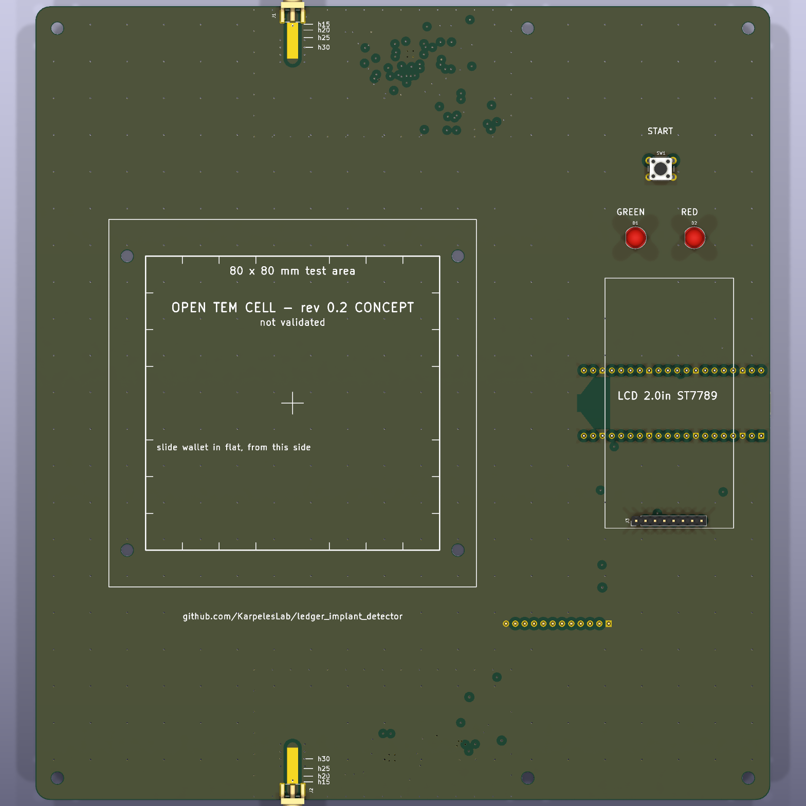
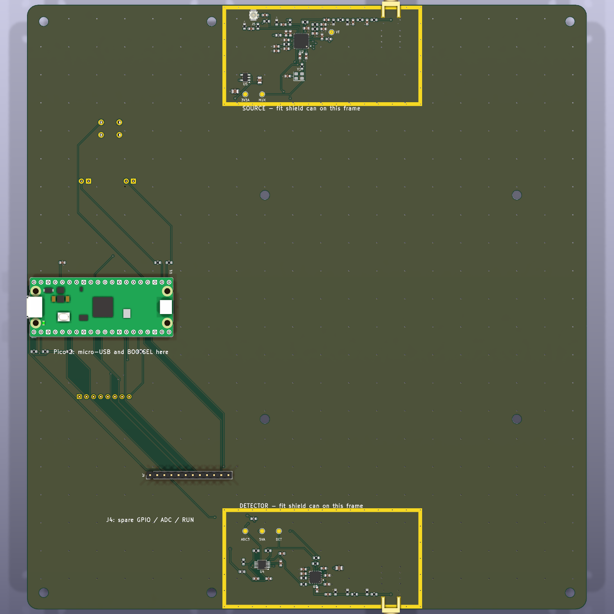

# Ledger Implant Detector

> **⚠️ STATUS: PROTOTYPE, NOT VALIDATED**
>
> Rev 0.2 of the integrated board has been built (5 boards, 2026-11) and its blocks work, but it
> has a ~12 dB notch around 1.4 GHz that has to be fixed before it can run the detection rule.
> Rev 0.3 fixes the most likely cause and is generated but not built. The detection rule itself
> rests on **one genuine and one tampered Nano X**. Do not rely on this device to declare a wallet
> "clean" until it has been characterised on many more units and this banner has been removed.

| top: the cell | underside: the electronics |
|---|---|
|  |  |

A bench box for spotting **implanted antennas inside hardware wallets** (e.g. a Ledger). The target
threat is a supply-chain implant that adds a cellular (LTE) modem to the device: its antenna is a
resonant structure that a genuine unit doesn't have.

You slide the wallet into an open **TEM cell**, press a button, and read a screen and a green or red
LED. There's no VNA, no cables and no positioning skill involved. It is powered and updated over USB.

## How it detects

A TEM cell is a stripline big enough to put a wallet in: a flat metal plate (the septum) held 20 mm
above a ground plane, with tapered ramps at each end. It sets up a fairly uniform field over an
80 x 80 mm test area, so the result hardly depends on where the wallet lies.

The board sweeps a signal through the cell and measures how much comes out the other side (|S21|).
An implant antenna tuned to an LTE band absorbs energy at its resonance, which shows up as a narrow
notch in the sweep. Placement, the battery and the wallet's own electronics only change the sweep
broadly.

**The rule:** wallet sweep minus empty-cell sweep, minus a 200 MHz running median, then look in
1.0-1.45 GHz for a notch at least 0.45 dB deep and 10-60 MHz wide. If one is found, the user re-seats
the wallet and the box sweeps again; two notches within 15 MHz give red. No per-model reference
wallet is needed, if this holds up on more units.

On the NanoVNA captures of 2026-10-26 (`tools/tem_detect.py`, details in
[docs/rev02_integrated.md](docs/rev02_integrated.md#why-a-magnitude-only-sweep-is-enough)):

| | result |
|---|---|
| tampered Nano X, all placements and both orientations | 12 of 12 flagged, 0.79-1.02 dB at ~1171 MHz |
| genuine Nano X | 13 of 14 clean (at most 0.24 dB); one outlier that didn't repeat |
| re-seat and repeat | tampered 8 of 8 pairs, genuine 0 of 10 |

The implant antenna's own S11 confirms the feature: it resonates at 1156-1245 MHz depending on what
surrounds it ([data/rf/2026-11-02/notes.md](data/rf/2026-11-02/notes.md)).

The thresholds were chosen after looking at these captures, so they set a hardware target (a sweep of
800-1600 MHz in 5 MHz steps, at most 0.05 dB of noise per point) rather than proving the rule.

## What it will miss

- **Compact coil antennas**, such as Joe Grand's tampered Nano X (a hand-wound ~6 mm spiral). It is
  too small to couple to the cell's uniform field and isn't seen in simulation. The capacitive array of
  [rev 0.1](docs/rev01_capacitive.md) caught it in simulation through the shortened battery, but that
  array is not on the current board. **A green result does not rule this type out.**
- **Implants built to dodge the rule**: a low-Q antenna, or a resonance outside the band.
- **Anything unmeasured**: Stax, Nano S Plus, a genuine Flex.

## The board

Generated into `hardware/integrated/` by `tools/gen_integrated_sch.py` and
`tools/gen_integrated_pcb.py`. Full design notes, calibration, firmware security and the USB data
interface are in [docs/rev02_integrated.md](docs/rev02_integrated.md).

- **One board is both the cell floor and the electronics**, 200 x 216 mm, 4 layers
  (JLC04161H-7628). Its top copper is the cell's ground plane with the two 3 mm landing lines; every
  part is on the underside. RF crosses the board through fenced vias, so there are no cables.
- **Septum and ramps** are the fixture kit's `tem_plate` and `tem_ramp` boards, on 20 mm nylon spacers.
- **Signal chain:** ADF4351 synthesizer (35 MHz - 4.4 GHz) → 10 dB pad → cell → 6 dB pad → AD8318
  log detector → ADS1115 16-bit ADC.
- **Control:** Raspberry Pi Pico 2 module (RP2350), 2 inch ST7789 LCD, green and red LEDs, one button.
- **Hacks:** fit SMA J1/J2 and remove R1/R20 to use the cell with a NanoVNA; U.FL J5 on the
  synthesizer's second output; spare GPIO and ADC lines on J4; test points on the RF blocks.

Ordering steps: [hardware/integrated/ORDER.md](hardware/integrated/ORDER.md).

### Status

| rev | state |
|---|---|
| 0.2 | 5 boards built (JLC, 2026-11). Synthesizer, detector, ADC, LCD, LEDs and USB all work with the bring-up firmware. A ~12 dB notch near 1.4 GHz appears on both boards. Bench tests ruled out the cell, leakage and the detector's soldering, and point to long stubs on the synthesizer's RFOUTA- termination and the detector's INLO decoupling (not yet confirmed) |
| 0.3 | Generated, not built. Every ADF4351 and AD8318 support part is placed by hand at its pin, +5VA is a pour under the detector, and the router is kept out of sensitive areas. See [Rev 0.3](docs/rev02_integrated.md#rev-03-layout-fixes) |

### Firmware

`firmware/bringup` is **bring-up firmware**, not the detector: it gives raw sweeps and per-block
checks over USB serial, with no verdict and no stored reference. Build it with the Pico SDK:

```sh
cmake -S firmware/bringup -B build/bringup -G Ninja -DPICO_SDK_PATH=/path/to/pico-sdk
ninja -C build/bringup
```

Flash `build/bringup/lid_bringup.uf2` by holding BOOTSEL on the Pico while plugging it in, or send
`bootsel` to running firmware. Then use `tools/bringup.py` (Linux):

```sh
python3 tools/bringup.py cmd status               # any firmware command (try: help)
python3 tools/bringup.py sweep 1000 1450 5        # raw sweep, start/stop/step in MHz
python3 tools/bringup.py noise 1000 1450 5 -n 5   # per-point spread in dB (target <= 0.05 dB)
```

The detector firmware still has to be written: self-check, the rule, the green/red result, signed
updates and the HID interface for specialist data collection.

## How we got here

1. **Rev 0.1, capacitive array plus RF loop** ([docs/rev01_capacitive.md](docs/rev01_capacitive.md)):
   a handheld with eight capacitive electrodes and a near-field loop for a NanoVNA. Not built.
2. **Simulations** ([docs/simulation.md](docs/simulation.md)): floating antenna copper hidden behind
   the battery isn't detectable capacitively, but an RF probe sees a narrow in-band absorption that
   plain copper doesn't.
3. **First NanoVNA session** on a tampered Nano X
   ([data/rf/2026-10-18/notes.md](data/rf/2026-10-18/notes.md)): a resonance was visible, but only
   with the probe right over the antenna's feed.
4. **RF fixture kit** ([docs/fixtures.md](docs/fixtures.md), `hardware/fixtures/`): a slot line and an
   open TEM cell to remove that position dependence. On 2026-10-26 the TEM cell showed the tampered
   unit's notch at every placement ([data/rf/2026-10-26/notes.md](data/rf/2026-10-26/notes.md)).
   Crossed and coaxial large loops were simulated too, and the TEM cell stayed the practical choice.
5. **Integrated TEM cell** (rev 0.2, then 0.3): the fixture with the NanoVNA replaced by an on-board
   scalar sweep.

## Repository layout

```
hardware/
  integrated/   the integrated TEM cell (KiCad 10), fab/ has gerbers, JLC BOM/CPL, schematic PDF
  fixtures/     NanoVNA fixture kit: slot line, TEM base, septum plate, ramps
  detector/     rev 0.1 capacitive board (not built)
  lib/          project symbols and footprints
firmware/
  bringup/      rev 0.2 bring-up firmware (Pico SDK)
tools/          generators for every KiCad project, NanoVNA capture and analysis, bringup.py
sim/            electrostatic and FDTD simulations
data/rf/        NanoVNA captures with session notes
docs/           design notes, simulations, measurements, renders
```

## Regenerating

The KiCad files are generated by the scripts in `tools/`, so the design is reviewable as code. Treat
the committed `.kicad_pcb` as the source of truth: the router isn't deterministic, so regenerating
gives a different layout.

The integrated board needs KiCad 10 (its Python `pcbnew` module and `kicad-cli`), Java 17+ and
[Freerouting](https://github.com/freerouting/freerouting) 2.1.0:

```sh
cd tools
python3 gen_integrated_sch.py
FREEROUTING_JAR=/path/to/freerouting-2.1.0.jar \
    FREEROUTING_EXTRA="--gui.enabled=false --router.job_timeout=00:10:00" \
    python3 gen_integrated_pcb.py           # place, hand-route RF and support parts, autoroute, pour
python3 gen_integrated_pcb.py --outputs     # gerbers, BOM/CPL, schematic PDF, renders, DRC/ERC
```

It can leave a few connections open. Run several attempts with `LID_PCB_OUT` set to different paths
and keep one with 0 unconnected in DRC. The fixtures come from `tools/gen_fixtures.py`; the rev 0.1
board's steps are in [docs/rev01_capacitive.md](docs/rev01_capacitive.md#files-and-regenerating).

## License

Not yet chosen.
