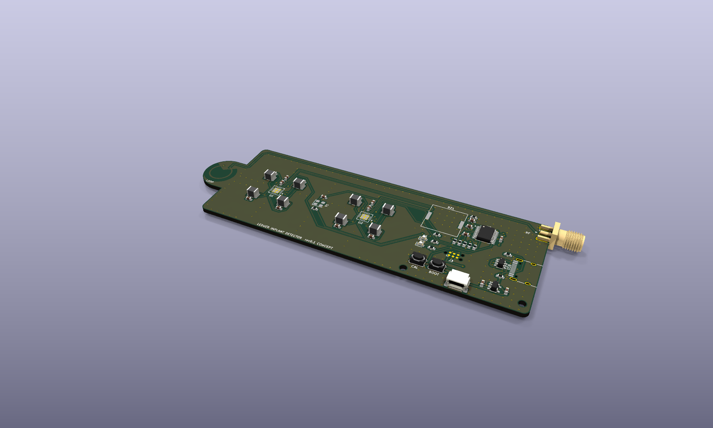
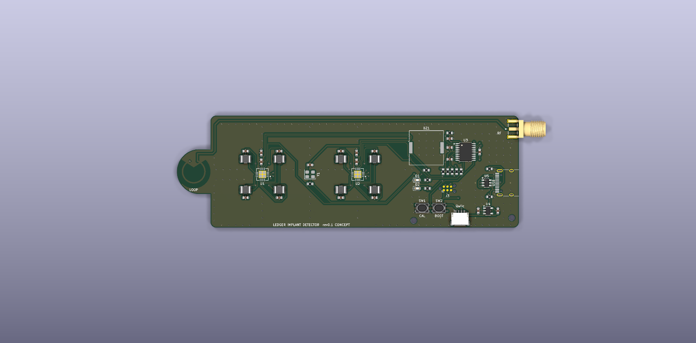
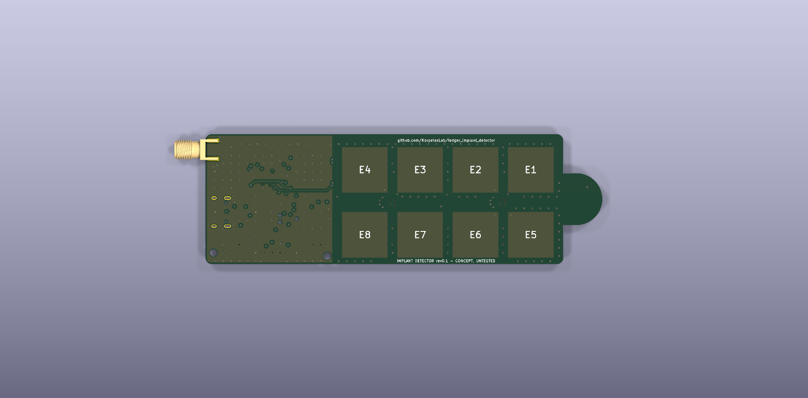
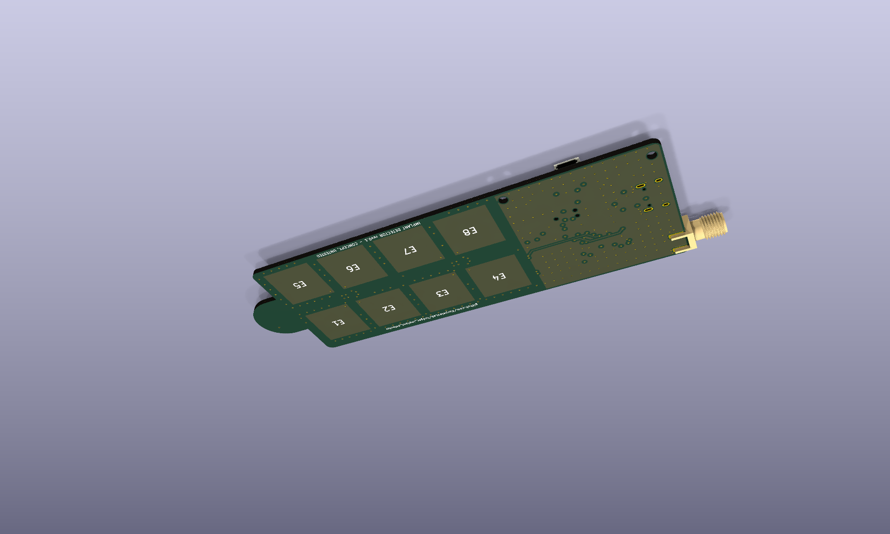
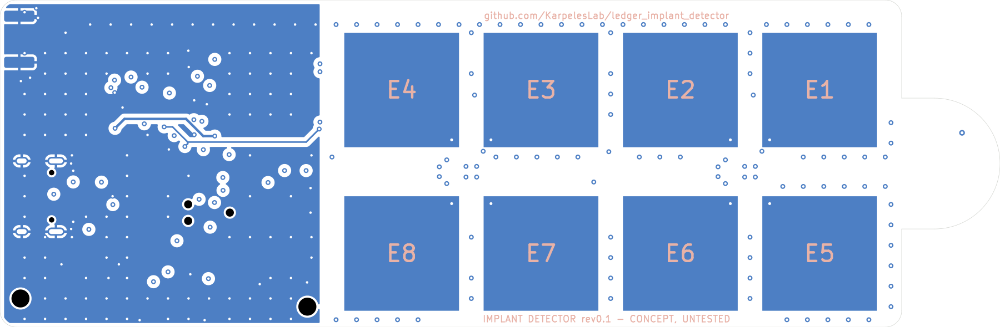

# Ledger Implant Detector

> **⚠️ STATUS: CONCEPT — NOT YET BUILT OR VALIDATED (rev 0.1)**
>
> This hardware has **not been fabricated or tested yet**. The schematic,
> layout and detection method are a first-pass concept and will almost
> certainly need errata. Do not rely on this device to declare a wallet
> "clean" until the design has been built, characterised against known-good
> and known-tampered devices, and this banner has been removed.



A small hand-held tool for spotting **extra conductive structures hidden inside
the plastic shell of a hardware wallet** (e.g. a Ledger). The target threat is
a supply-chain implant that adds a cellular (LTE) modem to the device: such
implants need a comparatively large antenna, i.e. a sizeable area of copper
that is not present in a genuine unit.

Everything is on **one board**, powered and programmed over a single USB-C
port. No programmer or debug probe is needed (see
[Programming](#programming-no-tools-needed)).

## How it detects

The tool combines two complementary methods:

### 1. Capacitive electrode array (primary)

Eight 14 × 14 mm copper electrodes on the underside of the head are read by two
TI **FDC2214** 28-bit capacitance-to-digital converters (LC-resonant, EMI
tolerant). Any conductor close to a plate (an antenna trace, a ground plane, a
battery…) increases that plate's capacitance and lowers its resonance
frequency, which the FDC2214 measures with very high resolution.

The detector does **not** recognise an antenna by itself: a genuine wallet
also contains copper (PCB, battery, display, Bluetooth antenna, NFC coil on
newer models). The method is **differential**:

1. Lay a *known-genuine* unit of the same model on the head in a fixed
   orientation (a 3D-printed jig is recommended) and record the 8-channel
   signature (the "reference").
2. Lay the unit under test in the same position and compare.
3. A significant positive deviation localised to one or more electrodes means
   "more conductor here than in the reference" → open the device / investigate.

The array covers 65 × 34 mm, enough for a Nano S Plus / Nano X in a single
placement; Stax / Flex need two or more positions.

### 2. Near-field RF loop at the tip (secondary, needs a VNA)

The nose of the board carries a printed 8 mm H-field loop, fed by a 50 Ω
microstrip that runs back to an **edge SMA connector** next to the USB-C port.
Plug in an inexpensive VNA (NanoVNA / LiteVNA), sweep S11 from roughly
600 MHz to 3 GHz and hover the tip over the wallet. You are looking for
**resonances in the LTE bands** that a genuine unit does not show.

This is complementary to the capacitive method: capacitance tells you *where
there is extra copper*, and the RF sweep hints at *whether that copper is tuned
like an antenna*. Results are again comparative (reference unit vs. unit under
test). The wallet's own ground plane, battery, Bluetooth antenna and NFC coil
all produce responses of their own, and a hidden antenna's resonance shifts
with its surroundings.

## Board

| Top | Bottom (sensing side) |
|---|---|
|  |  |



### Electrode map

Bottom copper, **seen from below** (i.e. the face you put against the wallet):



| Electrode | Converter | Channel |
|---|---|---|
| E1 / E5 / E6 / E2 | U1 (I²C 0x2A) | CH0 / CH1 / CH2 / CH3 |
| E3 / E7 / E8 / E4 | U2 (I²C 0x2B) | CH0 / CH1 / CH2 / CH3 |

Electrode numbering (E1…E4 = row nearest the RF edge, E1 nearest the nose) is
also printed on the bottom silkscreen.

### Stack-up

4 layers, 1.6 mm (JLC04161H-7628):

| Layer | Use |
|---|---|
| F.Cu | components, routing, GND pour, RF microstrip (0.35 mm ≈ 50 Ω over In1) |
| In1.Cu | solid GND: RF reference plane, and passive shield behind the electrodes so the hand holding the tool is not sensed |
| In2.Cu | routing **only outside the electrode areas** (keep-outs over every electrode); GND pour under the handle |
| B.Cu | the 8 electrodes (solder-mask covered); GND pour under the handle only |

Each FDC2214 sits on top of the board in the gap between its four electrodes,
so the sensor feed-throughs are only a few millimetres long.

### Parts

| Block | Part | Notes |
|---|---|---|
| CDC ×2 | TI FDC2214RGHR | single-ended sensors, 0x2A / 0x2B |
| Tank ×8 | 18 µH (Bourns CMH322522-180KL) ‖ 33 pF C0G 1 % | ≈ 5–6.5 MHz, values from the TI datasheet / EVM |
| Clock | 40 MHz CMOS oscillator (Abracon ASE) | shared by both FDCs |
| MCU | STM32F042F6P6 (TSSOP-20) | crystal-less USB FS, ROM USB-DFU bootloader |
| USB | USB-C (HRO TYPE-C-31-M-12), USBLC6-2SC6 ESD | 5.1 kΩ CC pull-downs (sink, 5 V only) |
| Power | AP2112K-3.3 LDO | |
| RF | printed 8 mm loop + Samtec SMA-J-P-H-ST-EM1 edge SMA | |
| UI | green + red LED, Murata PKLCS1212E piezo, CAL + BOOT buttons | |
| Expansion | JST-SH 4-pin (Qwiic / STEMMA-QT pinout) for an optional I²C OLED | |
| Debug | Tag-Connect TC2030-NL footprint (SWD), no part needed | |

### MCU pin map

| Pin | Function |
|---|---|
| PF0 / PF1 | I2C1 SDA / SCL (both FDCs + Qwiic) |
| PA0 / PA1 | FDC U1 / U2 INTB (10 k pull-ups) |
| PA2 | FDC SD (shutdown, both chips; 100 k pull-down = running) |
| PA3 / PA4 | LED green / red (active high) |
| PA5 | CAL button (to GND, enable internal pull-up) |
| PA6 | piezo buzzer (TIM3_CH1 / TIM16_CH1 PWM) |
| PA11 / PA12 | USB D− / D+ (TSSOP-20 pins 17/18, set `SYSCFG_CFGR1.PA11_PA12_RMP`) |
| PA13 / PA14 | SWDIO / SWCLK (Tag-Connect pads) |
| BOOT0 | BOOT button to 3V3 (10 k pull-down) |

## Programming (no tools needed)

The STM32F042 has a USB-DFU bootloader in ROM, so firmware is flashed through
the same USB-C port that powers the board:

- **Fresh board:** an unprogrammed STM32F04x starts straight into the ROM DFU
  bootloader (this is how projects such as
  [dap42](https://github.com/devanlai/dap42) are flashed).
- **Later:** hold **BOOT** while plugging in USB (or have the firmware jump to
  the bootloader on a USB command), then:

```sh
dfu-util -a 0 -s 0x08000000:leave -D firmware.bin
```

STM32CubeProgrammer (USB mode) works too. The Tag-Connect SWD footprint is
only there as a recovery/debug path for people who own a probe.

> To validate on the first build: that ROM DFU enumerates on the TSSOP-20 package
> (USB on the remapped pins 17/18), and the option-byte state of the BOOT0 pin on
> the delivered parts.

## Suggested FDC2214 configuration

Starting point, from datasheet §8.2.3:

- `CLOCK_DIVIDERS_CHx = 0x2001` (`CHx_FIN_SEL = b10`, single-ended sensor; `CHx_FREF_DIVIDER = 1`)
- External 40 MHz clock: `CONFIG.REF_CLK_SRC = 1`
- Tune `DRIVE_CURRENT_CHx` so the tank amplitude is 1.2–1.8 Vpk (start around IDRIVE = 15)
- Autoscan all 4 channels: `MUX_CONFIG.AUTOSCAN_EN = 1`, `RR_SEQUENCE = b10`, deglitch 10 MHz

## Repository layout

```
hardware/
  lib/                  project symbols + footprints (FDC2214, electrode, near-field loop)
  detector/             KiCad 10 project (schematic + 4-layer PCB)
    fab/                gerbers + drill (zip), BOM, JLC BOM/CPL, schematic PDF
docs/img/               renders
tools/                  Python generators used to produce the KiCad files and outputs
```

The KiCad files were generated by the scripts in `tools/` so the first
revision is reviewable as code. They are ordinary KiCad projects, though: once
you edit them by hand in KiCad, treat the KiCad files as the source of truth.

Regenerating needs KiCad 10 (its Python `pcbnew` module and `kicad-cli`). Routing also
needs Java 17+ and [Freerouting](https://github.com/freerouting/freerouting) **1.9.0**.
1.9 routes this board completely; 2.x did noticeably worse on it. 1.9 needs an X
display, and `Xvfb` works.

```sh
python3 tools/gen_lib.py              # project library
python3 tools/gen_detector_sch.py     # schematic
Xvfb :97 & export DISPLAY=:97
FREEROUTING_JAR=/path/to/freerouting-1.9.0.jar FREEROUTING_PASSES=100 \
    python3 tools/gen_detector_pcb.py # placement, pre-routing, autoroute, pours, stitching
python3 tools/make_outputs.py         # gerbers/drill/BOM/CPL/PDF + renders
```

The PCB generator places everything, then hand-routes these parts deterministically:
the RF microstrip, the converters' digital escapes, the north-side power/control
escapes, the tank for the electrode diagonally opposite each converter's analog pins,
and a small bus to the handle. It fans every GND pad out to the In1 plane and lets
Freerouting do the rest. GND is not autorouted: it comes from pours on F.Cu / In1 (and
In2 / B.Cu under the handle) plus stitching vias.

Current check status (`hardware/detector/fab/*_report.txt`): ERC 0 violations;
DRC 0 errors, 0 unconnected, schematic parity OK. The remaining warnings are two
"silkscreen clipped by board edge" from the stock USB-C footprint and three
single-spoke thermal reliefs on pads that also have a direct via to the GND plane.

## Ordering

`hardware/detector/fab/` contains everything for a 4-layer PCB + assembly
order:

- `implant_detector_gerbers.zip`: select 4 layers, 1.6 mm, and the
  **JLC04161H-7628** stack-up (the 0.35 mm RF line is 50 Ω only on that stack-up).
  Minimum features: 0.15 mm track/space, 0.3 mm drill / 0.6 mm via, so no
  advanced-capability options are needed.
- `bom_jlc.csv` + `cpl_jlc.csv` (origin = bottom-left corner of the board).
  MPNs are given; only the USB-C connector has a pre-filled LCSC number, so
  let the assembler match the rest by MPN and **check the rotations in the
  assembly preview**, especially U1/U2/U3, the LEDs and J1.
- The edge-launch SMA (J4) straddles the board edge. If the assembler won't
  place it, it is easy to hand-solder.
- The electrodes, the RF loop and the Tag-Connect footprint are bare copper,
  not parts.
- `schematic.pdf` for reference.

## Open questions the first build must answer

- [ ] Actual sensitivity through 1–3 mm of ABS/PC to a thin flex-PCB antenna.
- [ ] Repeatability between placements (jig needed?) and drift with temperature / hand proximity.
- [ ] Whether the solid In1 GND shield behind the electrodes costs too much range
      (alternatives: hatched shield, active shield driver).
- [ ] Electrode size / pitch trade-off (resolution vs. range).
- [ ] RF loop: usable frequency range and repeatability with NanoVNA-class instruments.
- [ ] ROM DFU on the TSSOP-20 STM32F042 (see above).
- [ ] Reference signatures for each Ledger model.

## License

Not yet chosen.
