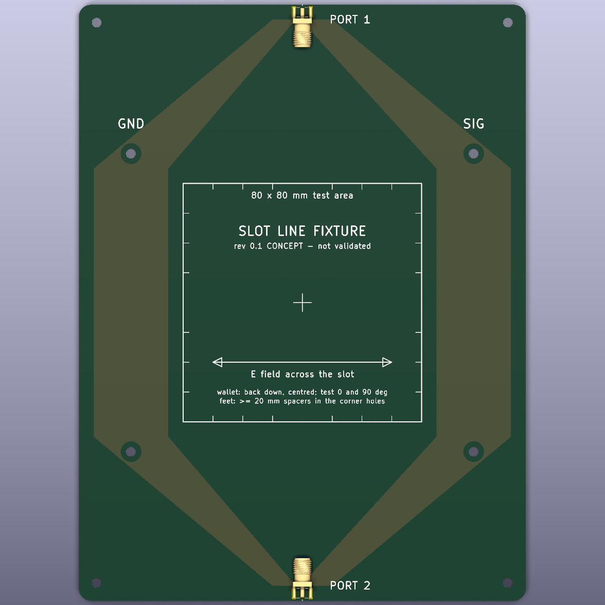
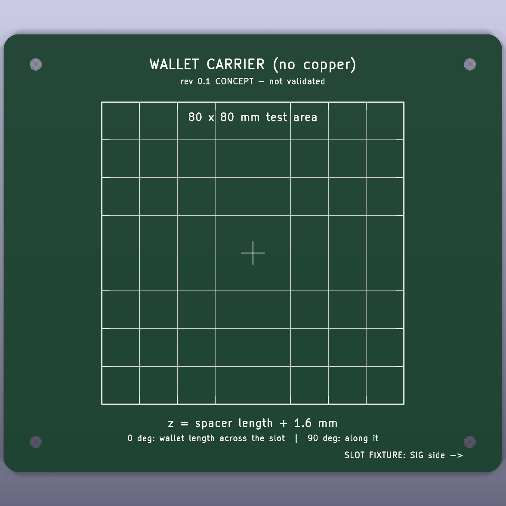
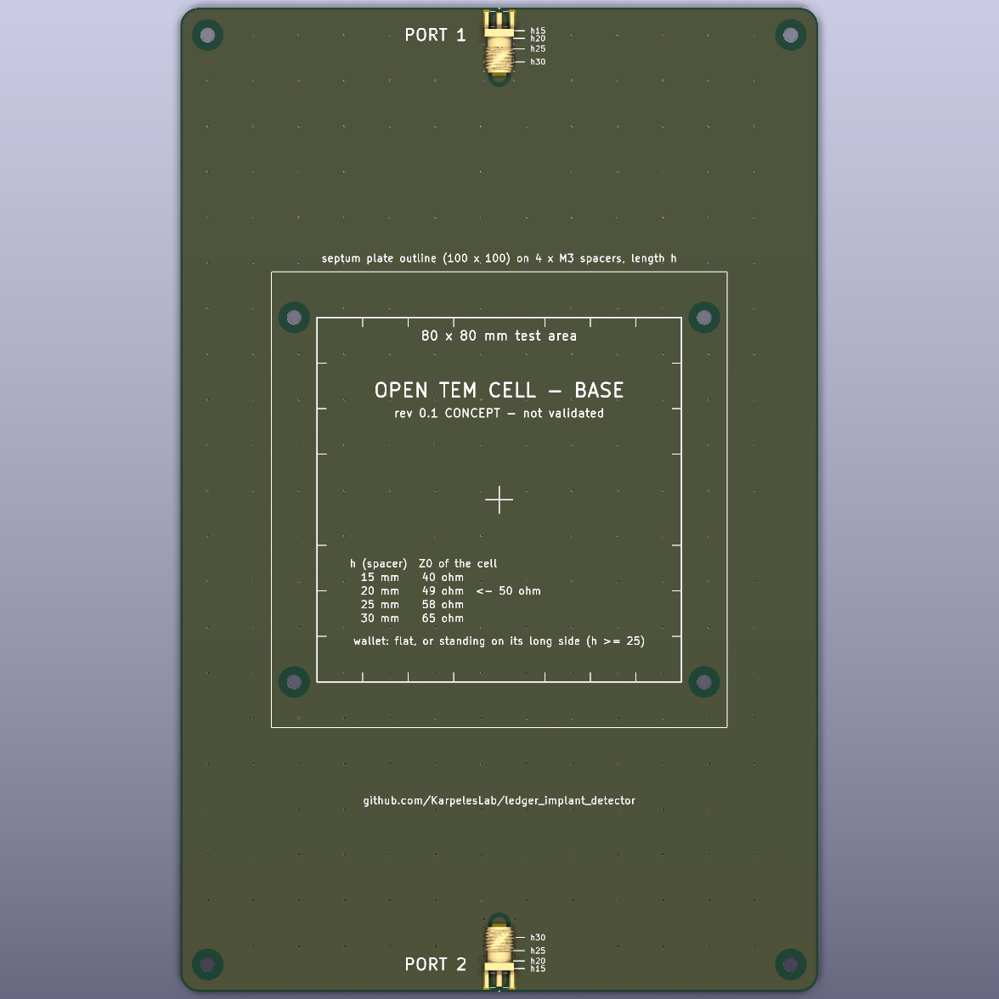
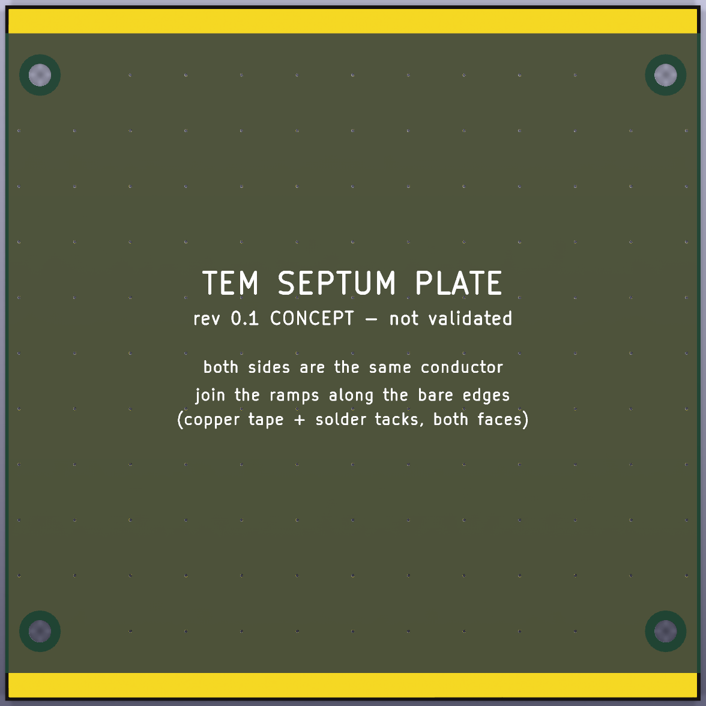
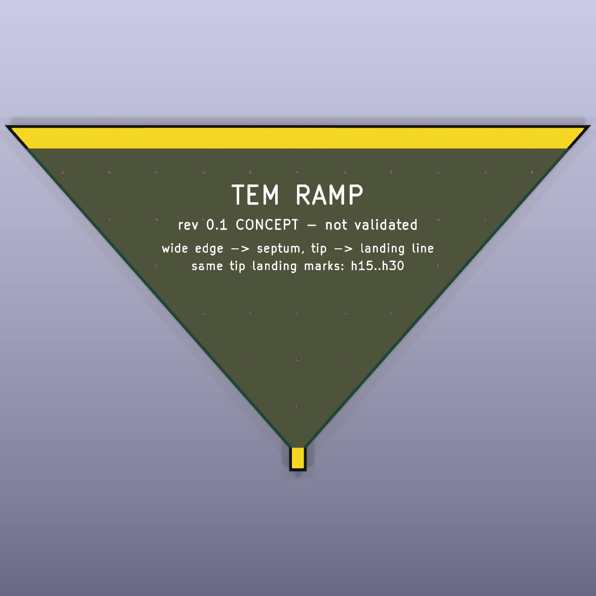

# RF test fixtures (rev 0.1 concept): position-independent NanoVNA tests

> Status: **concept, not built, not validated.** The boards are generated, DRC
> clean and simulated (see the end of this document). Nobody has measured one yet.

## Why these boards

The first NanoVNA session on a real implanted Nano X
([data/rf/2026-10-18/notes.md](../data/rf/2026-10-18/notes.md)) found a clear
signature. A ~10 mm H-loop held over the implant antenna's feed, transmitting to
an antenna 20-30 cm away, showed a resonant hump around 820-850 MHz: S21 about
+3 to +6 dB above free air on the tampered unit, against about -2 to -7 dB on the
genuine one. The catch is that the hump vanished when the loop sat a few
millimetres off the feed. A miss proves nothing, and an implant maker can simply
move the antenna.

These fixtures replace the small probe with a field that is roughly uniform over
an **80 x 80 mm test area**, so the antenna is excited wherever it is in the
wallet. The NanoVNA measures the whole wallet at once. The test asks whether
there is a tuned antenna resonance in the LTE bands, rather than where the
copper is. Untuned metal (the battery, the Ledger's own board and shield) gives
broad, smooth changes. A tuned antenna gives a narrow feature.

There are two fixtures, with different field directions, because simulation
alone can't yet say which one couples better to a flat antenna lying in a
wallet's back shell:

| fixture | field over the test area | wallet | ports |
|---|---|---|---|
| **slot line** (`slot`) | E **in the plane** of the wallet (across the slot) + vertical H | lies flat on a carrier plate, at a set height above the board | 2 x SMA: S11, S21 through the line |
| **open TEM cell** (`tem_base` + `tem_plate` + 2 x `tem_ramp`) | vertical E + horizontal H, very uniform | inside the cell, flat or standing on its long side | 2 x SMA: S11, S21 through the cell |

The `carrier` board is a copper-free FR4 plate with the 80 x 80 mm area, a
10 mm grid and centre marks, which holds the wallet at a known height above the
slot line.

All boards are 2-layer FR4, 1.6 mm, with no components except edge-mount SMA
jacks.

## Kit and ordering

| board | size | order | notes |
|---|---|---|---|
| `slot` | 150 x 200 mm | 1 | 2 x SMA edge jack |
| `carrier` | 132 x 116 mm | 1 | no copper at all |
| `tem_base` | 140 x 216 mm | 1 | 2 x SMA edge jack, landing lines left bare |
| `tem_plate` | 100 x 100 mm | 1 | copper both sides, stitched |
| `tem_ramp` | 100 x 59 mm | **2** | copper both sides, stitched |

Gerbers: `hardware/fixtures/<board>/fab/<board>_gerbers.zip`. Any finish works.
ENIG or lead-free HASL both solder well to copper tape. 1 oz copper.

Other parts:

- 4 x SMA edge jack for 1.6 mm boards (footprint: Samtec SMA-J-P-H-ST-EM1;
  most generic "SMA-KE" edge jacks fit);
- M3 **nylon** spacers and screws only, no metal near the test area: 4 x the
  carrier height (5 / 10 / 15 / 20 mm), 4 x the septum height (15 / 20 / 25 /
  30 mm), and 8 x >= 20 mm feet;
- conductive copper tape, 5-10 mm wide (TEM cell joints);
- for S11-only use, a 50 ohm SMA load on the other port. The NanoVNA's
  calibration load works.

Board renders:

| slot line | carrier |
|---|---|
|  |  |

| TEM base | septum plate | ramp |
|---|---|---|
|  |  |  |

## Slot line: assembly and heights

1. Solder the two SMA jacks: the centre pin on the narrow signal neck, and the
   legs top and bottom. The bottom-side copper under each jack joins its two
   ground legs.
2. Put >= 20 mm nylon feet in the four corner holes. The line radiates a little
   on both sides, so keep the table, metal and hands > 2 cm away. Lead both
   cables straight out of the ports and don't move them between captures.
3. The wallet lies **back down** on the carrier, centred on the 80 x 80 area.
   The four inner holes carry the carrier.

The height of the wallet's back above the copper is called z:

| carrier mounting | z |
|---|---|
| lying directly on the board | 1.6 mm |
| on 5 mm spacers | 6.6 mm |
| on 10 mm spacers | 11.6 mm |
| on 15 mm spacers | 16.6 mm |
| on 20 mm spacers | 21.6 mm |

The E field runs **across** the slot, from the SIG strip to the GND strip. A
straight antenna couples best when it lies along that direction. So measure
every wallet at **0 deg** (length across the slot) and at **90 deg** (length
along the slot). An implant antenna that has been turned 90 degrees inside a
larger wallet (Flex, Stax) is caught by the other orientation. The vertical H
part of the field doesn't care about orientation.

## Open TEM cell: assembly and heights

1. Solder the SMA jacks on the base. Their centre pins sit on the 3 mm landing
   lines, which are left bare where the ramp tips land.
2. Screw four nylon spacers of length **h** into the holes at (+-45, +-40) mm,
   and put the septum plate on top. Both faces of the plate and of the ramps are
   the same conductor.
3. Join each ramp's wide bare edge to a bare edge of the septum with copper
   tape on both faces, plus a few solder tacks. Let the ramp hang down to the
   base. Its tip lands on the landing line at the silk mark for your h
   (`h15` ... `h30`). Solder the tip to the line.
4. Feet in the corner holes, as for the slot line.

| h (spacer length) | cell impedance | notes |
|---|---|---|
| 15 mm | ~40 ohm | wallet lying flat only (Nano X is 11.75 mm thick) |
| 20 mm | ~50 ohm | best match; flat wallets |
| 25 mm | ~58 ohm | a Nano X standing on its long side (18.6 mm) fits |
| 30 mm | ~65 ohm | larger wallets on edge |

The mismatch at 15 and 30 mm is small enough for comparative tests, because
only differences against a reference wallet matter. The cell is usable up to
about 1.2 GHz. Above that, the 100 mm septum supports higher-order modes and
the response gets bumpy, so its main band is LTE low (700-960 MHz).

Inside the cell, E is vertical and H runs across the cell, horizontally. A flat
antenna lying flat couples mostly through its 3D parts (coax, modem board,
grounding). Standing the wallet on its long side, length along the cell, puts H
through the antenna's plane. Measure both ways.

## Measurement procedure

Calibrate full OSLT at the ends of the two cables, as in session 3 of the notes:
`cal reset` first, 50 MHz - 3 GHz. Then, without touching the cables:

1. **Empty fixture**, 3 captures. This gives the fixture's own response and the
   drift.
2. **Genuine reference wallet**: 3 placements at the centre, 0 deg, lifting it
   off and putting it back each time. Then 1 placement each at +20 mm in x, +20
   mm in y, and at 90 deg. This is the placement spread, i.e. the false-positive
   floor.
3. **Wallet under test**: the same placements.
4. Empty fixture again (drift check).

Capture with `tools/nanovna_capture.py capture <file>.s2p --start 300e6 --stop 3e9
--points 401 --avg 4`, and keep the file naming of `docs/rf_measurements.md`,
e.g. `slot_z6_nanox_u1_ref_c0_1.s2p` (fixture and height, wallet, placement c0 /
x20 / y20 / r90, repeat).

Compare with:

```sh
python3 tools/analyze_s1p.py --s21 --ref slot_z6_*_ref_*.s2p --test slot_z6_*_tamp_*.s2p
```

What to look for: a **narrow** feature (tens of MHz wide) in the LTE low band,
around 800-900 MHz on the units seen so far. It should be present at every
placement of the tampered unit and absent from all genuine placements. Broad
offsets of a dB or two that follow the wallet's position are placement effects,
not tampering.

## Simulation of the fixtures

`sim/fixtures_fdtd.py` models both fixtures in FDTD, with a Nano X-sized wallet:
plastic shell, battery, main board. The **tampered** wallet adds a meandered
antenna glued to the back shell, fed through a 100 nH matching coil into the
modem's 50 ohm, with the coax shield and the implant's modem board. The modem
ground is tied to the wallet's board, since the implant must take power from
the Ledger's battery. Alone in free space, the tampered wallet resonates at
835 MHz, like the hump measured on the real unit. The antenna layout is
generic, not a copy of the AC-A2016.

Results: *pending, the simulation batch is still running.*
