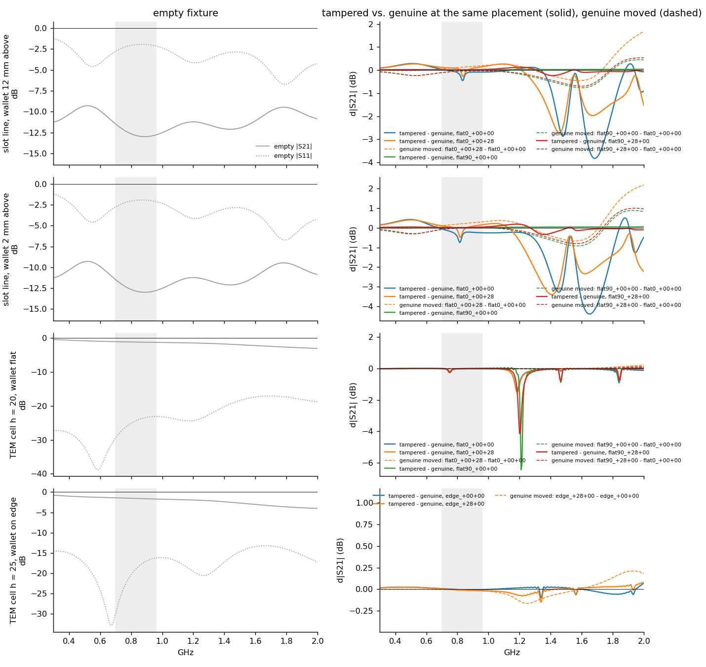
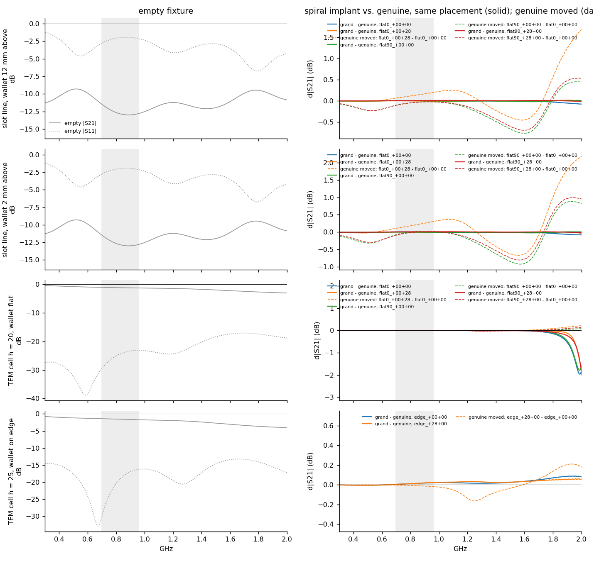
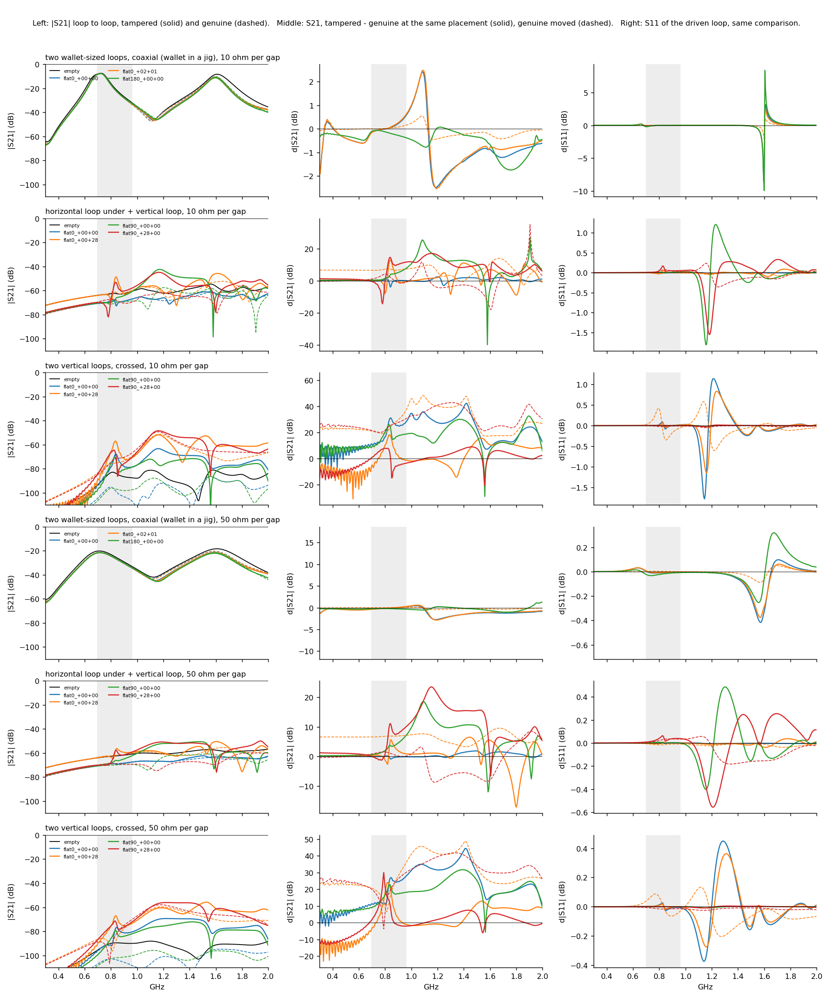

# RF test fixtures (rev 0.1 concept): position-independent NanoVNA tests

> Status: **concept, not built, not validated.** The boards are generated, DRC
> clean and simulated (see [the end of this document](#simulation-of-the-fixtures)).
> Nobody has measured one yet.

## Why these boards

The first NanoVNA session on a real implanted Nano X
([data/rf/2026-10-18/notes.md](../data/rf/2026-10-18/notes.md)) found a clear
signature. A ~10 mm H-loop held over the implant antenna's feed, transmitting to
an antenna 20-30 cm away, showed a resonant hump around 820-850 MHz: S21 about
+3 to +6 dB above free air on the tampered unit, against about -2 to -7 dB on the
genuine one. The catch is that the hump vanished when the loop sat a few
millimetres off the feed. A miss proves nothing, and an implant maker can simply
move the antenna.

These fixtures replace the small probe with a field that is roughly uniform over
an **80 x 80 mm test area**, so the antenna is excited wherever it is in the
wallet. The NanoVNA measures the whole wallet at once. The test asks whether
there is a tuned antenna resonance in the LTE bands, rather than where the
copper is. Untuned metal (the battery, the Ledger's own board and shield) gives
broad, smooth changes. A tuned antenna gives a narrow feature.

There are two fixtures, with different field directions. In simulation, both
see the meander/FPC-style implant at every placement tested, through different
features (see the results below), and only a real measurement can say which
works better. Neither sees a compact wire-spiral antenna; the capacitive array
covers that case (see the last section):

| fixture | field over the test area | wallet | ports |
|---|---|---|---|
| **slot line** (`slot`) | E **in the plane** of the wallet (across the slot) + vertical H | lies flat on a carrier plate, at a set height above the board | 2 x SMA: S11, S21 through the line |
| **open TEM cell** (`tem_base` + `tem_plate` + 2 x `tem_ramp`) | vertical E + horizontal H, very uniform | inside the cell, flat or standing on its long side | 2 x SMA: S11, S21 through the cell |

The `carrier` board is a copper-free FR4 plate with the 80 x 80 mm area, a
10 mm grid and centre marks, which holds the wallet at a known height above the
slot line.

All boards are 2-layer FR4, 1.6 mm, with no components except edge-mount SMA
jacks.

## Kit and ordering

| board | size | order | notes |
|---|---|---|---|
| `slot` | 150 x 200 mm | 1 | 2 x SMA edge jack |
| `carrier` | 132 x 116 mm | 1 | no copper at all |
| `tem_base` | 140 x 216 mm | 1 | 2 x SMA edge jack, landing lines left bare |
| `tem_plate` | 100 x 100 mm | 1 | copper both sides, stitched |
| `tem_ramp` | 100 x 59 mm | **2** | copper both sides, stitched |

Gerbers: `hardware/fixtures/<board>/fab/<board>_gerbers.zip`. Any finish works.
ENIG or lead-free HASL both solder well to copper tape. 1 oz copper.

Other parts:

- 4 x SMA edge jack for 1.6 mm boards (footprint: Samtec SMA-J-P-H-ST-EM1;
  most generic "SMA-KE" edge jacks fit);
- M3 **nylon** spacers and screws only, no metal near the test area: 4 x the
  carrier height (5 / 10 / 15 / 20 mm), 4 x the septum height (15 / 20 / 25 /
  30 mm), and 8 x >= 20 mm feet;
- conductive copper tape, 5-10 mm wide (TEM cell joints);
- for S11-only use, a 50 ohm SMA load on the other port. The NanoVNA's
  calibration load works.

Board renders:

| slot line | carrier |
|---|---|
|  |  |

| TEM base | septum plate | ramp |
|---|---|---|
|  |  |  |

## Slot line: assembly and heights

1. Solder the two SMA jacks: the centre pin on the narrow signal neck, and the
   legs top and bottom. The bottom-side copper under each jack joins its two
   ground legs.
2. Put >= 20 mm nylon feet in the four corner holes. The line radiates a little
   on both sides, so keep the table, metal and hands > 2 cm away. Lead both
   cables straight out of the ports and don't move them between captures.
3. The wallet lies **back down** on the carrier, centred on the 80 x 80 area.
   The four inner holes carry the carrier.

The height of the wallet's back above the copper is called z:

| carrier mounting | z |
|---|---|
| lying directly on the board | 1.6 mm |
| on 5 mm spacers | 6.6 mm |
| on 10 mm spacers | 11.6 mm |
| on 15 mm spacers | 16.6 mm |
| on 20 mm spacers | 21.6 mm |

The E field runs **across** the slot, from the SIG strip to the GND strip. A
straight antenna couples best when it lies along that direction. So measure
every wallet at **0 deg** (length across the slot) and at **90 deg** (length
along the slot). An implant antenna that has been turned 90 degrees inside a
larger wallet (Flex, Stax) is caught by the other orientation. The vertical H
part of the field doesn't care about orientation.

## Open TEM cell: assembly and heights

1. Solder the SMA jacks on the base. Their centre pins sit on the 3 mm landing
   lines, which are left bare where the ramp tips land.
2. Screw four nylon spacers of length **h** into the holes at (+-45, +-40) mm,
   and put the septum plate on top. Both faces of the plate and of the ramps are
   the same conductor.
3. Slide each ramp's wide bare edge **under** the septum plate so that its
   4 mm bare strip overlaps the plate's 4 mm bare strip. Tape them with copper
   tape on both faces, and add a few solder tacks. Let the ramp hang down to
   the base. The ramp is rigid, so the end of its 4 mm tab is what touches the
   base. With the 4 mm overlap, that point is on the landing line at the silk
   mark for your h (`h15` ... `h30`, to within ~1 mm). Solder the tip to the
   line.

   Do not butt the ramp against the plate's edge instead. The tip then lands
   4-5 mm further out, on the SMA's centre pin at h = 20 and past it at
   h = 15. Boards generated before this fix had silk marks that ignored the
   tab. They sit 0.3-0.7 mm inward of the overlapped tip, which is close
   enough.
4. Feet in the corner holes, as for the slot line.

| h (spacer length) | cell impedance | notes |
|---|---|---|
| 15 mm | ~40 ohm | wallet lying flat only (Nano X is 11.75 mm thick) |
| 20 mm | ~50 ohm | best match; flat wallets |
| 25 mm | ~58 ohm | a Nano X standing on its long side (18.6 mm) fits |
| 30 mm | ~65 ohm | larger wallets on edge |

The mismatch at 15 and 30 mm is small enough for comparative tests, because
only differences against a reference wallet matter. The cell is usable up to
about 1.5 GHz in simulation. Above that, the 100 mm septum supports
higher-order modes and the response gets bumpy. Use it for LTE low
(700-960 MHz) and up to ~1.5 GHz.

Inside the cell, E is vertical and H runs across the cell, horizontally. A flat
antenna lying flat couples mostly through its 3D parts (coax, modem board,
grounding). Standing the wallet on its long side, length along the cell, puts H
through the antenna's plane. In simulation the flat position gave a strong
notch and the edge position gave nothing, so start with flat (0 and 90 deg).

## Measurement procedure

Calibrate full OSLT at the ends of the two cables, as in session 3 of the notes:
`cal reset` first, 50 MHz - 3 GHz. Then, without touching the cables:

1. **Empty fixture**, 3 captures. This gives the fixture's own response and the
   drift.
2. **Genuine reference wallet**: 3 placements at the centre, 0 deg, lifting it
   off and putting it back each time. Then 1 placement each at +20 mm in x, +20
   mm in y, and at 90 deg. This is the placement spread, i.e. the false-positive
   floor.
3. **Wallet under test**: the same placements.
4. Empty fixture again (drift check).

Capture with `tools/nanovna_capture.py capture <file>.s2p --start 300e6 --stop 3e9
--points 401 --avg 4`, and keep the file naming of `docs/rf_measurements.md`,
e.g. `slot_z6_nanox_u1_ref_c0_1.s2p` (fixture and height, wallet, placement c0 /
x20 / y20 / r90, repeat).

Compare with:

```sh
python3 tools/analyze_s1p.py --s21 --ref slot_z6_*_ref_*.s2p --test slot_z6_*_tamp_*.s2p
```

What to look for: a **narrow** feature (tens of MHz wide) in the LTE low band,
around 800-900 MHz on the units seen so far. It should be present at every
placement of the tampered unit and absent from all genuine placements. Broad
offsets of a dB or two that follow the wallet's position are placement effects,
not tampering.

Check that the NanoVNA has recalled the calibration slot that covers your span
(`recall 0`). The device boots into the last recalled slot, and points outside
that slot's calibration span read 0.

## Measured results, 2026-10-26

First session with the kit as ordered: one genuine Nano X (`u1`) and the real
implanted Nano X (FPC antenna variant), NanoVNA-F V2, 50 MHz - 3 GHz, 401
points, 4x averaging. The raw data and the full log are in
[`data/rf/2026-10-26/`](../data/rf/2026-10-26/notes.md). All numbers are S21,
the wallet capture minus the mean of the genuine centred 0 deg captures.

**TEM cell, h = 20 mm, wallet flat: the implant is seen at every placement.**

| | result in 1100-1300 MHz |
|---|---|
| tampered, 12 captures (centre x9, 20 mm along, 20 mm across, 90 deg) | **narrow notch at 1171 MHz in all 12**: -0.95..-1.10 dB at 0 deg, -0.8 dB 20 mm along, ~-0.65 dB at 90 deg; ~40 MHz wide |
| tampered, interleaved run (6 captures, each lifted out and replaced) | -0.95..-0.99 dB, all at 1171 MHz |
| genuine, 19 captures | 18 within -0.22..+0.07 dB (interleaved run, leave-one-out reference: -0.19..+0.03 dB) |
| genuine outlier (#4, first after the tampered set) | -1.1 dB, ~100 MHz wide, centred ~1230 MHz; not repeated in 7 later placements, cause unknown |

The simulation predicted **-1.2 dB at 1185 MHz** for this setup, from the
implant's coax and modem board. The measured depth and frequency are within
1-2 % of that. The one miss is orientation: the simulation gave 90 deg the
deeper notch (-6.3 dB), but measured 90 deg is the weaker one. The weak 750 MHz
antenna notch from the simulation could not be separated from a baseline shift
of the cell after the cables were moved.

**Slot line, wallet on the carrier (z = 1.6 mm): weak and orientation-bound, as
predicted.** At 0 deg a dip at 817-861 MHz of -0.13..-0.20 dB at all five
tampered placements, against -0.05..+0.03 dB for the independent genuine
placements. That is the antenna's resonance, the band of the 10 mm loop hump,
at about a third of the simulated -0.5 dB. At 90 deg there is nothing, as
predicted. Most of what the wallet seems to do to the slot line (a step at
~800 MHz, a hump at ~1.1 GHz, up to +-1 dB) is the carrier's FR4, not the
wallet.

**What this means for now:**

- For this implant, the TEM cell is the test to use. Look for a ~40 MHz wide
  notch of about 1 dB that shows at the same frequency at every placement. A
  single notch near 1.2 GHz on its own is not proof yet, because genuine
  capture #4 shows that something can make a similar notch. Its frequency
  (1230 vs 1171 MHz) and width set it apart, and it did not repeat.
- The slot line confirms the antenna's resonance at 0 deg, but with ~0.15 dB of
  margin it is not a test on its own.
- This is one genuine and one tampered unit. Next: narrow, higher-resolution
  sweeps of 700-800 and 1100-1300 MHz, a second genuine unit, and a true empty
  slot line capture to close the slot data.

## Simulation of the fixtures

`sim/fixtures_fdtd.py` models both fixtures in FDTD, with a Nano X-sized wallet:
plastic shell, battery, main board. The **tampered** wallet adds a meandered
antenna glued to the back shell, fed through a 100 nH matching coil into the
modem's 50 ohm, with the coax shield and the implant's modem board. The modem
ground is tied to the wallet's board, since the implant must take power from
the Ledger's battery. Alone in free space, the tampered wallet resonates at
835 MHz, like the hump measured on the real unit. The antenna layout is
generic, not a copy of the AC-A2016.

Each fixture was simulated empty, then with the genuine and the tampered
wallet at two placements per orientation: centred, and 28 mm off centre (along
the slot, or along the cell). The two sides of each comparison use the same
placement. 32 runs in total, ~1.1 h each. Touchstone files:
`sim/results/fixtures/`. Figure and table: `python sim/report.py fixtures`.



Left: the empty fixture. Right: tampered minus genuine at the same placement
(solid), and genuine at another placement minus genuine centred (dashed). The
dashed curves are the false-positive floor. Grey band: 700-960 MHz.

| fixture, orientation | narrow notch, tampered vs. genuine | same notch at the 28 mm offset | genuine moved 28 mm (spread) |
|---|---|---|---|
| slot line z = 2 mm, 0 deg | **-0.5 dB at 815-820 MHz**, ~20 MHz wide | -0.55 dB | 0.3 dB, broad |
| slot line z = 12 mm, 0 deg | -0.37 dB at 835 MHz | -0.38 dB | 0.2 dB, broad |
| slot line, 90 deg (either z) | none (< 0.01 dB) | none | 0.1 dB |
| TEM h = 20, flat, 0 deg | -0.17 dB at 750 MHz; **-1.2 dB at 1185 MHz** | -0.17 / -1.3 dB | **0.01 dB** |
| TEM h = 20, flat, 90 deg | -0.26 dB at 750 MHz; **-6.3 dB at 1210 MHz** | -0.25 / -3.9 dB | 0.03 dB |
| TEM h = 25, on edge | none (< 0.03 dB) | none | 0.02-0.17 dB |

### What this says

1. **Both flat setups see the implant at every placement simulated, which the
   10 mm loop could not do.** The notch keeps its depth to within a few tenths
   of a dB when the wallet moves 28 mm. So the field really is uniform enough
   over the test area. The genuine wallet produces only broad, smooth changes
   when it moves.
2. **The slot line reproduces the measured signature.** At 0 deg it shows a
   narrow notch at 815-835 MHz. That is the antenna's own resonance (835 MHz in
   free space), and the same band as the hump measured with the loop. It is
   small (0.4-0.5 dB) and sits on a 0.2-0.3 dB broad placement spread, but it is
   ~20 MHz wide, where the spread is hundreds of MHz wide. Lowering the wallet
   from 12 to 2 mm makes it a little deeper and pulls it down 15-20 MHz.
3. **The slot line is blind at 90 deg.** Its in-plane E field must lie along
   the antenna. So measure every wallet at both 0 and 90 deg, as described
   above: a turned antenna is caught by the other orientation.
4. **The TEM cell, wallet flat, is the most placement-proof setup.** A genuine
   wallet moved 28 mm changes S21 by only 0.01-0.03 dB. The tampered wallet
   shows a narrow notch near 1.2 GHz of 1.2 dB (0 deg) to 4-6 dB (90 deg), at
   every placement and in both orientations. Its antenna resonance is only a
   weak -0.2 dB notch at 750 MHz: lying flat over the base, 2-3 mm from ground,
   it is detuned down and barely excited by the vertical E field. The 1.2 GHz
   notch is a resonance of the implant's 3D parts (coax, modem board and its
   ground tie to the wallet's board), which the vertical E field drives well.
   **Its frequency depends on the model and is not a prediction.** On a real
   implant, expect a narrow notch somewhere in 0.7-1.5 GHz, and compare against
   the genuine reference rather than looking at a fixed frequency.
5. **Standing the wallet on edge in the TEM cell shows nothing** (< 0.03 dB).
   The antenna's plane then contains the E field and the 3D parts are turned
   away from it. Skip it unless the measurements say otherwise.
6. Above ~1.2 GHz the slot line radiates (30-50 %) and moving the wallet
   changes S21 by several dB, so only use its 700-1000 MHz range. The TEM cell
   stays clean to ~1.5 GHz.

**Recommended first measurements:** the TEM cell at h = 20 mm with the wallet
flat (0 and 90 deg), then the slot line at z = 1.6 or 6.6 mm (0 and 90 deg).
No board change came out of the simulation, so the kit can be ordered as
generated.

Limits: the antenna is a generic meander tuned to 835 MHz, not the AC-A2016.
The modem is a 50 ohm resistor behind a 100 nH coil. The battery and board are
perfect conductors. The real implant's ground connection is still unknown, and
without the ground tie the 1.2 GHz notch would likely change or disappear.
Treat the depths as an order of magnitude.

## Second implant variant: a hand-wound spiral

Joe Grand's tampered Nano X
([slides](https://grandideastudio.com/media/ledger_hardware_implant_slides.pdf),
pp. 33-38) uses a different antenna: ~8 cm of ~0.3 mm copper wire hand-wound
into a ~6 mm pancake spiral of ~6 uneven, nearly touching turns. It lies half
over the edge of the implant's own board and is fed directly by the modem.
The Ledger's battery is replaced by a shorter one to make room. The
capacitive array sees that shortened battery clearly (see
[simulation.md](simulation.md), point 6).

`sim/fixtures_fdtd.py` models it as a 6 mm square spiral of 80 mm of wire,
1 mm above the implant board and overlapping its edge by 3 mm, fed by the
modem's 50 ohm at its outer end. The battery is shortened and the implant board
is tied to the wallet's ground. Alone in free space it resonates at 835 MHz.
That depends on the unknown height and winding: 795-865 MHz for 0.5-1.5 mm
above the board, and 660-700 MHz if the turns couple more tightly
(`sim/results/fixtures/tune_grand_*.s2p`). At resonance the modem sees only
~10 ohm. The same 14 placements as above were run, plus three genuine
reference runs on the spiral case's finer grid. Those differ from the normal
runs by < 0.02 dB, so the grid itself adds nothing.



**In simulation, neither fixture sees this implant.**

- In the LTE low band (700-960 MHz), the spiral implant changes S21 by less
  than 0.02 dB at every placement, in both fixtures and all orientations.
- The broad changes it does cause (up to 0.35 dB on the slot line) are the
  same size as those from merely moving a genuine wallet.
- The TEM cell shows a narrow notch at ~2.18 GHz (0.5-2 dB), from a higher
  resonance of the coil. Above 2 GHz, though, the cell is no longer a clean
  TEM line: a genuine wallet moved 28 mm gives narrow changes of up to 1.5 dB
  there too. That rules it out as a test.

The reason is size. The coil is a 6 mm loop lying 1 mm over its own board's
ground, so its field stays between the coil and the board. A field spread over
80 x 80 mm hardly links to it. The meander implant above has copper running
along the whole wallet, and its coax and modem board stick up into the field.
A real implant with a matching network would absorb more at its resonance, but
it would still couple just as weakly.

What does catch this variant is the **capacitive array**. Its shortened
battery leaves 1.3-3.4 pF above the worst placement error on one electrode
([simulation.md](simulation.md), point 6). That also tells you where to look.
A small loop held over that spot, like the detector's own 8 mm loop or the
H-loop used in the NanoVNA sessions, couples to a 6 mm coil by mutual
inductance, which no uniform-field fixture can do. That probe has not been
simulated over this coil yet.

What to do with the fixtures: they are still the position-independent test
for antennas spread along the wallet, like the meander/FPC type. A clean result
on a fixture does **not** rule out a compact coil antenna. Always run the
capacitive scan as well.


## Large loops: crossed and coaxial (simulation only)

Suggested as an alternative: two large H-field loops at 90 degrees. Port 1
drives one loop and port 2 is the other. The loops are orthogonal, so empty
they barely couple, and S21 sits on a null. An antenna that couples to both
should show as a narrow S21 peak over that null, like an induction-balance metal
detector. The opposite option was also suggested: two wallet-sized loops on the
same axis, under and over the wallet, measuring the strong S21 straight
through, with a jig fitting the wallet so that it cannot move.

`sim/xloop_fdtd.py` models three setups, with the meander implant and the same
genuine/tampered wallets as above:

| setup | loops | field on the wallet | placements |
|---|---|---|---|
| `xv` crossed | two vertical loops, 110 and 120 mm square, crossing above and below the wallet | H along x and along y | as above: 0 / 90 deg, centred and 28 mm off |
| `hv` crossed | 110 mm horizontal loop 5 mm under the wallet + 116 mm vertical loop | H vertical and along y | as above |
| `cx` coaxial | two 82 x 30 mm loops, 5 mm under and 3 mm over the wallet | H vertical, strong through path | jig: centred, slipped 2 x 1 mm, turned end for end |

A 110 mm loop is more than a wavelength around at 1 GHz, so each loop is cut
into 35-40 mm segments by gaps. Each gap holds a series capacitor (0.8 pF; 1.4
pF for `cx`) that tunes the loops to ~900 MHz, and a damping resistor (10 or
50 ohm). The ports sit on the other loop's mirror plane, so the empty crossed
loops cancel by symmetry: -80 dB for `xv`, -57 dB for `hv`. The solver gained a
lumped capacitor for this. Figure and table: `python sim/report.py xloop`.



Results, 10 ohm per gap. The 50 ohm loops were worse in every setup.

| setup | tampered vs. genuine, same placement | genuine moved |
|---|---|---|
| `xv` crossed | **narrow S21 peak at 825-840 MHz at all 4 placements**, 10-13 dB above the curve's own running median; genuine 0-1.5 dB off centre, 6 dB centred. S11 of the driven loop: -1.2..-1.8 dB at ~1150 MHz at 0 deg only | genuine S21 level rises 43-48 dB when moved 28 mm |
| `hv` crossed | peak at 840 MHz only when off centre (13 dB); centred 0 / 90 deg: < 4 dB. S11: -1.6..-1.8 dB at ~1160 MHz at 90 deg only | 10-12 dB |
| `cx` coaxial | **nothing in 700-960 MHz** (< 0.6 dB, broad band-edge slopes); a +2.4 / -2.5 dB swing over ~100 MHz at 1.08-1.19 GHz, centred and slipped; only -0.8 dB turned end for end | 0.55 dB for a 2 mm slip |

### What this says

1. **The crossed vertical loops (`xv`) see the antenna's own resonance at every
   placement and in both orientations.** That is the 820-860 MHz band of the
   10 mm loop hump and of the slot line, which the TEM cell barely shows. The
   contrast is large, but the level is low: the tampered peak is at **-57 to
   -70 dB** absolute, about where a NanoVNA's dynamic range ends. With 50 ohm
   damping it falls to -67..-79 dB.
2. **The null is not a stable baseline in practice.** A genuine wallet 28 mm off
   centre breaks the symmetry and raises S21 by ~45 dB, to -50..-60 dB. So the
   test must look for a *narrow* peak, not a level. A real hand-built pair will
   also null far less deeply than the model's -80 dB. Subtracting the empty
   fixture's complex S21 recovers some of that, but the absolute level remains
   the problem.
3. **The loops are poorly matched (~200-550 ohm at the port).** A matching
   transformer on each loop should raise the signal. That has not been
   simulated.
4. **A field straight through the flat antenna barely excites it.** Neither
   `cx` nor the horizontal loop of `hv` (centred) sees the 835 MHz resonance,
   just as the TEM cell with the wallet on edge saw nothing. The meander couples
   to fields lying in its plane. What `cx` and `hv` do see is the ~1.2 GHz
   resonance of the implant's coax and modem board, the one the TEM cell
   measured at 1171 MHz. In `cx` it is a +-2.5 dB swing over ~100 MHz, but it
   falls below 1 dB when the wallet is turned end for end, so it depends on
   which end of the jig the antenna sits.
5. **Orientation:** the crossed loops are blind where an antenna lines up with
   only one loop. In `xv` both 0 and 90 deg worked, through the antenna's
   coupling to both loops. 45 deg cannot be modelled on this grid. Measure two
   orientations anyway.

**Compared with the TEM cell:** the TEM cell gives a ~1 dB notch on a 0 dB
through signal. A NanoVNA measures that easily, and it was measured on the real
implant at every placement. The crossed loops give a 10+ dB contrast on a
signal 60-70 dB down. That is a better *contrast* but a harder *measurement*.
Remember also that on the real unit the slot line gave a third of its
simulated depth. Crossed loops would be worth building as a second,
independent test of the antenna's own resonance, with matched loops and a VNA
with more dynamic range than the NanoVNA-F V2. They do not replace the TEM
cell. The spiral implant was not run in the loop fixtures. It is a 6 mm coil
and would probably couple just as weakly as it does to the slot line and TEM
cell.
