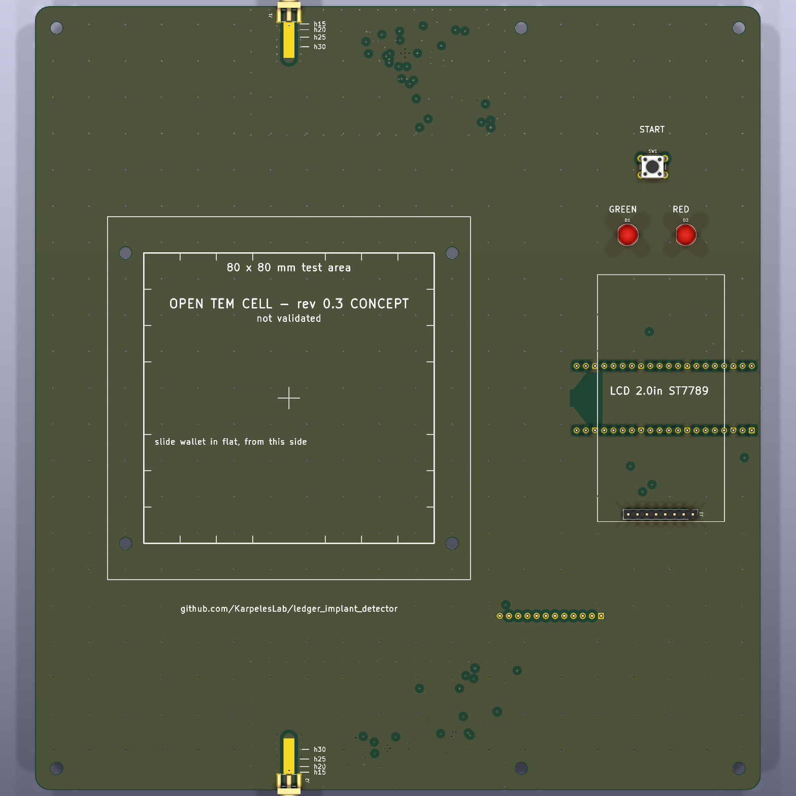
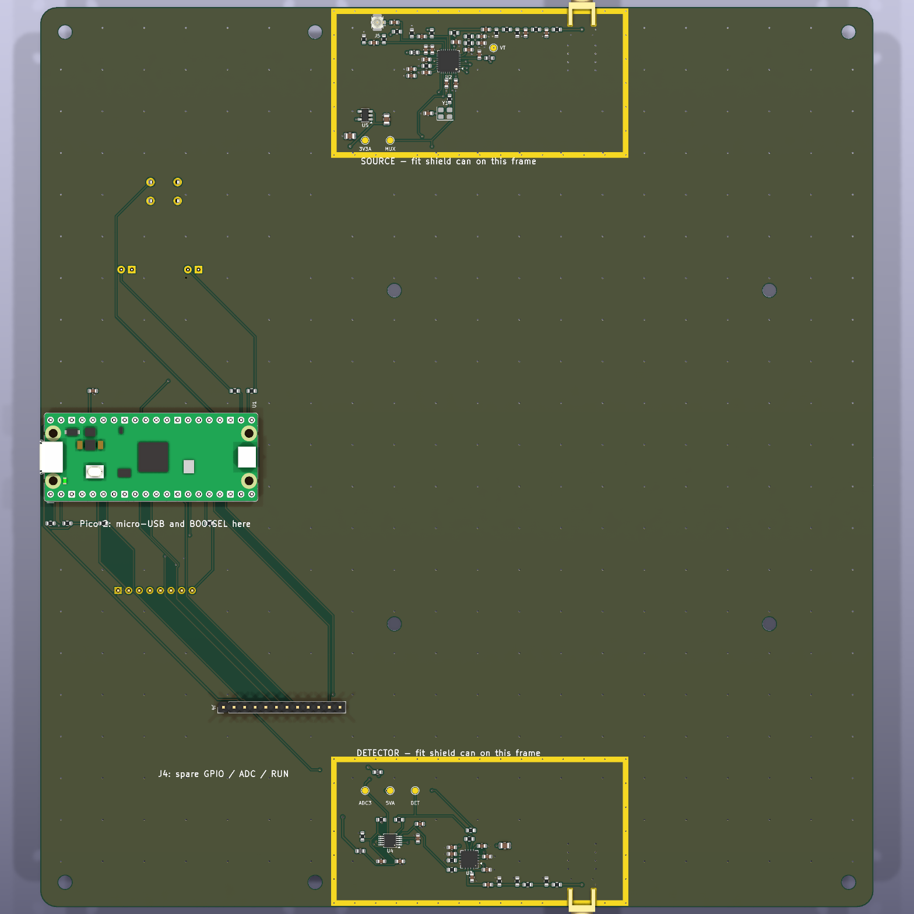

# Rev 0.2: integrated TEM cell detector (design proposal)

> Status: **rev 0.2 built (5 boards, 2026-11), rev 0.3 generated, not built.** Rev 0.2 works but
> has a ~12 dB notch around 1.4 GHz, most likely from long stubs on the synthesizer's RFOUTA-
> termination and the detector's INLO decoupling (not yet confirmed); see
> [Rev 0.3](#rev-03-layout-fixes). The rest of this page describes the design as proposed. The
> evidence it was based on is one genuine and one tampered Nano X in the cell, plus S11 of a
> tampered Flex's antenna. See [what still needs testing](#test-before-relying-on-it).

## The idea

One self-contained box. Slide the wallet into the cell, press a button, read a
screen and a green or red LED. No VNA, no cables, no positioning skill. It is
powered and updated over USB-C. Over the same port, a specialist's app or website can
trigger sweeps and collect labelled data, which normal use never shows.

It is the open TEM cell of [fixtures.md](fixtures.md) with the NanoVNA replaced
by a magnitude-only sweep on the cell's own board.

```
                       wallet here
          +------------------------------------+
  synth   |  ramp     septum on 20 mm    ramp  |   log
ADF4351 ->| pad ->       spacers           ->  |-> pad -> AD8318 -> 16-bit ADC
    ^     +------------------------------------+               |
    |            cell ground = top of the board                |
    +---- SPI ---- RP2350 ---- I2C ----------------------------+
                     |
          USB-C, LCD, green + red LED, button
```

## Why a magnitude-only sweep is enough

`tools/tem_detect.py` runs the proposed rule on the real TEM captures of
2026-10-26, using |S21| only, and degrades them the way cheap hardware would.

**The rule:** wallet sweep minus empty-cell sweep, minus a 200 MHz running median
(placement effects are broad), then look in 1.0-1.45 GHz for a notch at least
0.45 dB deep and 10-60 MHz wide.

| check | result |
|---|---|
| tampered captures, all placements and both orientations | 12 of 12 flagged, 0.79-1.02 dB |
| genuine captures | 13 of 14 clean, at most 0.24 dB |
| genuine #4, the known outlier | flagged against one of three empty references (0.57 dB, 59 MHz) |
| **re-seat and repeat**: two placements in a row must both flag, within 15 MHz | **tampered 8 of 8 pairs, genuine 0 of 10** |
| simulated meander implant in the cell (`sim/results/fixtures/`) | flagged at all 4 placements |
| simulated Joe Grand spiral implant | **not flagged at any placement** |

Hardware budget from the same captures, without the outlier:

| per-point noise | 5 MHz step | 10 MHz step | 15 MHz step |
|---|---|---|---|
| 0.02 dB | no errors | no errors | no errors |
| 0.05 dB | no errors | 1 false alarm in 540 | 1 false alarm in 540 |
| 0.10 dB | 27 false alarms in 540 | 42 in 540 | 36 in 540, 2 misses |
| 0.20 dB | many errors | many errors | many errors |

So the targets are **a sweep of 800-1600 MHz in 5 MHz steps (161 points), with at
most 0.05 dB of noise per point**,
about 1.25 mV at the AD8318's 25 mV/dB. Source harmonics hardly matter: even
-10 dBc at the 2nd and 3rd harmonic leaves every tampered capture flagged, because
the same harmonics are in the empty sweep too. That model assumes the detector
adds harmonics as power, which the breadboard has to confirm.

These thresholds were chosen after looking at these same captures, so the table
shows what the hardware must deliver. It does not show that the rule is right. The rule
needs no per-model reference, which would be a big simplification, but only the
genuine Nano X supports that so far.

## Electronics

| block | proposed part | why |
|---|---|---|
| source | ADF4351 (35 MHz - 4.4 GHz) | far wider than needed, so firmware can change the sweep later. MAX2871 is the second source |
| source pad | 10 dB | with the ADF4351 at its lowest setting (-4 dBm), about -14 dBm in the cell. Firmware keeps it there: low radiation, and the pad improves the match |
| receive pad | 6 dB | isolates the detector from the cell's -6..-10 dB match |
| detector | AD8318 (1 MHz - 8 GHz, 25 mV/dB) | about -25 dBm at its input with this budget. Single source, so check stock and a second source before layout |
| ADC | ADS1115, or similar 16-bit | 0.005 dB per LSB. The RP2350's own ADC is too noisy for 1.25 mV without heavy averaging |
| MCU | Raspberry Pi Pico 2 module (RP2350) | low risk for a first build: flash, crystal, supply and USB are already solved, and it is cheap to replace. ROM USB bootloader that can't be bricked, plus signed boot (see below) |
| power | USB through the Pico's micro-USB, separate 3.3 V LDO for the RF parts | the AD8318 needs 4.5-5.5 V from VBUS, so the ADC also measures VBUS and firmware reports a low supply |
| screen | 2 inch ST7789 SPI LCD module, about 320 x 240 | cheap and readable |
| indicators | large green and red LEDs, 1 button | the button starts a test. No model selection is needed if the rule holds |
| storage | the Pico's flash | firmware and the factory empty-cell sweep. Measurements are not stored |
| optional | footprint for a low-pass filter after the source, not fitted | keeps full sweep freedom unless regulatory testing requires it |

**Ambient RF is the main weakness of this architecture.** A log detector reports
all power at its input, and the open cell picks up whatever is nearby. A base
station at about -50 dBm into the cell is harmless (about 0.02 dB), but a phone
transmitting next to the box could disturb a sweep. Firmware handles this by
reading the detector with the source off before each sweep, and by taking the
median of several sweeps. If the background is too high, the result is "move your
phone away and retry", never a verdict. A heterodyne receiver would be immune but
costs a second synthesizer and a mixer. Only move to that if the breadboard says
the scalar version can't cope.

## Mechanics

- **One board is both the cell floor and the electronics.** Its top copper is the
  cell's ground plane, with the same 3 mm landing lines as the measured fixture.
  All parts go on the underside, under shield cans. The floor separates them from
  the wallet.
- **No SMA connectors or cables.** RF crosses the board through fenced vias. Moving
  the cables shifted the empty cell's baseline by about 0.2 dB in the measurements,
  so this removes a known variable.
- **Stack-up:** 4 layers. Inner layers are cut away under the landing lines so the
  3 mm line stays 50 ohm as in the fixture.
- **Layout:** 200 x 216 mm. The user sits at the -x side and slides the wallet in
  from there. The screen, LEDs, button and USB are beyond the cell at the +x side,
  at least 35 mm from the septum. Source at one port and detector at the other
  keeps leakage between them low.
- **Septum:** the same `tem_plate` and `tem_ramp` boards as the fixture, on nylon
  spacers, h = 20 mm, ramps overlapping the plate by 4 mm. Other heights still work.
- **A printed tray with stops (not designed yet)** keeps the wallet inside the test area
  and off the ramps. Its raised floor would also make the gap too low for a Nano X on edge
  (18.6 mm), because in simulation on edge shows nothing. A floor of about 3 mm
  leaves a 17 mm gap, but that height has not been measured.
- **Enclosure:** non-metal, and open or at least 30 mm clear above the septum.

## Data collection by specialists over USB

Trusted security specialists use the device to gather labelled measurements on
genuine and implanted wallets. This is how models we don't have get measured (Flex,
Stax, Nano S Plus), and how the rule gets tested on more than one unit of each kind.

Normal use doesn't change: there is no menu or button for this, and the device **never
stores or sends anything on its own**. Without a computer actively asking for a sweep,
no measurement leaves the box.

**How a session works.** A specialist logs in to a website or app, which talks to the
device over WebHID and guides them through a protocol. For each sample the site
triggers a sweep, receives the raw data, and the specialist labels it there and then.
Protocols live on the site, so a new campaign needs no firmware change.

| recorded for each sample | why |
|---|---|
| raw detector readings, including empty-cell and source-off sweeps | so future rules can be replayed on old data |
| verdict from the current rule | to score rules against the labels |
| sweep settings, firmware and rule versions, board revision, internal temperature | to separate real effects from hardware or drift |
| chip unique ID | to spot one bad unit or batch |
| wallet model and how its state is known (opened and confirmed implant, opened and confirmed genuine, or not opened), plus placement | the label. Only opened units set thresholds |

**USB interface.** The whole system can be driven over USB, for specialist work and for
bench debugging.

- **Transport:** vendor-defined HID, which suits WebHID (Chromium browsers, HTTPS, user
  picks the device; Linux needs a udev rule). A script can use the same interface through
  `hidapi`. The module's USB is native, so this is purely firmware.
- **Commands:** identify, status (lock, temperatures, VBUS), run a sweep, read raw
  results, single-frequency reading, source on/off within limits, read the references, and
  reboot to the bootloader.
- **Detailed sweeps:** start, stop, step, averages per point, settling time and output
  level are all set by the host. The ADF4351 reaches 35 MHz - 4.4 GHz with kHz-level
  steps, so 1 MHz steps over 800 MHz (801 points) take about 5 s at 4 averages on the
  ADS1115. Faster sweeps can use the Pico's own ADC through fitting R31. The cell itself
  is only clean up to about 1.5 GHz.
- **USB IDs:** the device needs its own VID/PID. Check whether a free PID is available
  from Raspberry Pi or pid.codes.

**Rules that keep this safe:**

- **USB can't touch the verdict.** A host-triggered sweep never lights the green or red
  LED or shows a result, and can't change the rule table. Otherwise a malicious web page
  or computer could fake a green. Rules change only through signed firmware.
- **Firmware clamps the settings.** A host can't exceed the fixed RF power limit, leave
  the allowed frequency range, or run the source continuously.
- **The screen shows when USB is sweeping.** The wallet owner should be able to see that
  the device is transmitting at someone else's request.
- **It is not secret.** Hiding it from the normal interface is fine, but the USB interface
  is visible to anyone who plugs the device in, and the design is public. One plain line
  in the manual ("a connected app can run sweeps; nothing is stored or sent on its own")
  keeps an undisclosed feature from being "discovered" later on a security product.

**Data integrity and privacy.** Specialists have named accounts, so a submission can be
traced and a bad source removed. People still review any rule change, because an implant
maker could try to get in or compromise an account. Samples must not carry the wallet's
serial number or its owner's identity, because owning a hardware wallet can make someone
a target, as the 2020 Ledger customer data leak showed.

**Early units.** The rule is only proven on one Nano X pair, so the screen must say the
result is **experimental** until there is more data. A confident green on an untested Flex
would be worse than no answer.

**Existing data.** NanoVNA captures in `data/rf/` can be converted to the same format and
marked as a different instrument.

## Calibration

**The owner never calibrates anything.** There are no standards to connect, and no
reference wallet.

The rule only looks for a narrow notch against a smooth baseline, so it doesn't need
absolute accuracy, and the captures support that. Every capture was run against every
empty-cell capture, including ones from before the cables were moved, about an hour
apart:

| | result with an old empty-cell reference |
|---|---|
| tampered captures | 72 of 72 comparisons flagged, always at 1171 MHz, at least 0.60 dB |
| genuine captures | flagged only for the known outlier #4 (4 of its 6 comparisons), otherwise at most 0.25 dB |
| empty cell against empty cell | at most 0.17 dB |

| when | what happens | who does it |
|---|---|---|
| factory | one empty-cell sweep is stored as the unit's reference, and each unit gets its own, since RF ripple differs by unit | an automatic end-of-line test |
| power-on | a new sweep is compared with the factory one. If it matches it becomes the working reference, otherwise the unit reports a fault | automatic |
| each test | the wallet sweep is compared with the working reference and with the factory reference. Either one showing a notch counts | automatic |
| if the self-check fails (a ramp moved, a part failed) | the screen says the unit needs service, and never shows green | the owner sees it |

**Why the factory reference stays in the loop.** If a wallet were left in the cell at
power-on, the working reference would contain its notch and the test would subtract it,
which would be a false green. So a power-on sweep is rejected if the rule finds a notch
in it against the factory reference, and the factory reference can't be written over USB.

**No wallet sensor.** The button starts a test. With an empty cell the result is "No
implant signature found", which is correct: no wallet means no implant.

**What this doesn't prove.** These captures cover about an hour on a NanoVNA. Months of
drift, temperature swings, and the real synthesizer and detector still have to be tested.
If drift turns out to be worse, the fallback is already there: rely on the fresh empty
sweep.

## How a test goes

1. **Self-check, automatic.** The empty-cell sweep from [Calibration](#calibration), plus
   synthesizer lock, background level and USB voltage. A broken RF path must never show
   green.
2. **Put the wallet in and press the button.** Check the background, then sweep.
3. **No notch: green.** The screen says **"No implant signature found"**, not
   "clean" or "safe" (see the limits below).
4. **Notch found:** the screen asks you to lift the wallet out and put it back, then
   sweeps again.
5. **Notch again within 15 MHz: red**, with the frequency and depth shown. If the
   second sweep is clean, repeat once more before deciding.

The whole test should take well under a minute. A sweep of 161 points takes about
1-3 s, depending on averaging.

## Firmware updates, and keeping them trustworthy

Updates exist because future implants may be built to dodge the detector. The same
port also creates the obvious attack: **reflash the detector so it always
shows green.** So the design should accept signed firmware only.

- **RP2350 signed boot.** The boot ROM checks a signature against a key hash stored
  in one-time-programmable memory, so unsigned images don't run once the part is
  locked. Add a version counter in OTP as well, since signed boot alone doesn't stop
  a downgrade to an older, weaker release.
- **Updates over USB.** Drag-and-drop UF2 through the ROM bootloader, reached with a
  recessed button or a command.
- **Detection rules as data.** Sweep span, bands and thresholds live in a signed
  table, so most updates against new implants don't touch the code.
- **Show the version** on the screen and let the device report it over USB, so an
  owner can compare it with the published release.
- **Limits:** glitching attacks on this boot path have been published, so this stops
  remote and casual tampering, not a determined attacker with the box on a bench.

## The board

Generated by `tools/gen_integrated_sch.py` and `tools/gen_integrated_pcb.py` into
`hardware/integrated/`. It reuses the fixture's `tem_plate` and `tem_ramp` boards. Ordering
steps are in [hardware/integrated/ORDER.md](../hardware/integrated/ORDER.md).

| top | underside |
|---|---|
|  |  |

Check status (`hardware/integrated/fab/*_report.txt`): DRC 0 errors, 0 unconnected, schematic
parity OK. What remains are silkscreen warnings and the landing lines' open ends, which are
intentional. ERC shows 1 error: the Pico symbol's GND and AGND pins are both power outputs, and
they are meant to be joined. These checks prove the layout matches the schematic, not that the
circuit works. Rev 0.2 has been built and its blocks work with `firmware/bringup`; rev 0.3 has
not been built.

The router isn't deterministic, so regenerating gives a different layout, and it can leave a
few connections open. Run a few attempts with `LID_PCB_OUT` set to different paths and keep a
clean one; 2.1.0 was used. Treat the committed `.kicad_pcb` as the source of truth.

**Pin map (Pico 2):**

| GPIO | function | GPIO | function |
|---|---|---|---|
| 0, 1 | I2C SDA, SCL (ADS1115 at 0x48) | 14, 15 | LCD DC, RST |
| 2, 3 | ADF4351 CLK, DATA | 16, 17 | green, red LED |
| 4 | ADS1115 ALERT/RDY | 18 | start button |
| 5, 6, 7 | ADF4351 LE, CE, PDBRF | 19 | spare, on J4 |
| 8, 9 | ADF4351 LD, MUXOUT | 20, 21, 22 | spare, on J4 |
| 10, 11 | LCD SCK, SDA (SPI1) | 26, 27 | spare, on J4 (ADC0, ADC1) |
| 12, 13 | LCD backlight, CS | 28 | detector fast path via R31, not fitted (ADC2) |

ADS1115 inputs: AIN0 detector, AIN1 detector temperature, AIN2 VBUS / 2, AIN3 spare on J4.

**Loop filter:** R12 510 ohm, C7 1.5 nF, C8 15 nF, R13 330 ohm, C9 680 pF, calculated for about
63 kHz and 50 degrees at 2.5 mA charge pump, 40 MHz/V, N = 124. Program the 2.5 mA setting in
firmware. Phase noise doesn't matter here, so this only has to lock cleanly. Check it with
ADIsimPLL if the lock is slow or unstable.

**Room for hacks:**

| hack | how |
|---|---|
| use the cell with a NanoVNA | fit SMA J1/J2 and remove links R1/R20. The cell then works just like the fixture, which also lets you check a built unit against the existing data |
| change source or receive level | both pads are ordinary 0603 parts |
| add a low-pass filter | L1 is a 0 ohm link, with empty pads for shunt C1 and C2 |
| second RF output, such as a small probe for coil antennas | U.FL J5 on the synthesizer's second output, programmable and normally off |
| second detector or anything analog | ADC_3 on J4 and a test point |
| spare control and analog lines | GP19-22, GP26-27 (two more ADC inputs) and RUN on J4, for a sensor or anything else later |
| faster detector readings | fit R31 to reach the Pico's ADC |
| probing | test points on detector output, VTUNE, MUXOUT and both analog rails |
| other cell heights | landing marks for h = 15, 20, 25, 30 and the same spacers |
| swap the MCU | the Pico is on standard 0.1 inch pins and can be socketed |
| shield cans | a bare ground frame around each RF block, for a folded can if leakage is a problem |

**Checks to make on the design before ordering:**

- **Micro-USB, not USB-C.** This comes from using the Pico module, and it is the first thing to
  replace in a later revision.
- The LCD header pinout (GND, VCC, SCK, SDA, RES, DC, CS, BL) is the common order for these
  modules, but it varies by seller, so check yours against J3 before ordering.
- Decoupling values on the ADF4351's VCOM, VREF and TEMP pins are my choice, because the
  datasheet's application circuit wasn't available to me. They are normal values, and C13 has
  a spare footprint on VCOM.
- The 0.35 mm width for 50 ohm assumes the JLC04161H-7628 stack-up, and the stub to the unfitted
  SMA pad is 2.8 mm.
- The analog 3.3 V rail is a pour on In1 inside the source block, +5VA one inside the detector
  block, and the ADC runs from the Pico's 3.3 V through a ferrite bead.
- Signals between the MCU and each RF block run on In1 and enter on the underside. If digital
  noise reaches the detector, the shield frames are the first thing to try.

## Rev 0.3: layout fixes

Bench tests on the rev 0.2 boards (2026-11-17) ruled out the cell, leakage and U3's soldering for the
1.4 GHz notch. It moves with neither power level nor cell, and a NanoVNA driving the detector directly
shows no deep notch. Rev 0.2 left the small parts round U2 and U3 to a greedy placer that kept 2.8 mm
clear of the chips for the router. They landed 7-35 mm from their pins, and the router wired RFOUTA-
through 45 mm to its pull-up and termination, and INLO through 22 mm to its decoupling. Both stubs
are long enough to resonate in the band, so they are the main suspect. The J5 test (driving the
cell from output B) should confirm it. Rev 0.3 changes only the layout, except for one added capacitor:

- **RF terminations at the pins** (`rf_terminations()`): RFOUTA+/- and RFOUTB+/- leave straight from
  the pins and turn at three depths, so nothing crosses. Each net is under 2 mm, except RFB+/- (17 mm,
  only used through J5). INLO's C22 sits straight below the pin.
- **Every other U2/U3 part at its pin** (`support_parts()`): VVCO decoupling (C16, C15, FB2) on one
  line from pin 17; TEMP, RSET, VCOM and VREF parts in two columns beside the chip, 1.5-6 mm of
  track each. The loop filter is a short spine at CP (pin 7). VTUNE drops to In1 at pin 20 and runs
  under the chip between the exposed pad vias, about 10 mm and buried between ground planes. TP2
  sits next to the loop filter on a short In1 branch. Y1 is turned to face REFIN, with R14 at its
  output. Every detector part is within 2 mm of its pin.
- **+5VA is a pour on In1** under the detector, like +3V3A under the source. FB1 moved from the Pico
  to where VBUS enters the detector frame, so VBUS stays outside the can, and a new 10 uF bulk
  capacitor (C35) sits at U3. Rev 0.2 ran +5VA 179 mm from the Pico, between
  C21's pads and along the INHI line.
- **The router is kept out of** the gap between the two pads of every small part, and In1 under
  both chips. A keepout along the 50 ohm chains stalled the router, so instead the generator
  lists any track within 1 mm of the hand-drawn RF lines (on the committed board, only DET_TEMP
  for 0.5 mm at U3).
  U2's digital pins are fanned out by hand to vias, and Y1's rail has a locked In1 track to U2,
  so the digital lines can't cut it off from the +3V3A pour.
- **Ground:** three more vias round each cell feed via. Exposed-pad vias sit in a cross between 4
  paste windows instead of inside them, so they don't wick the solder away. Ground pads get
  thermal reliefs for hand soldering, except the RF ones.

Two independent reviews (agents, 2026-11-18) checked the copper. The first, on the board with only
the RF terminations fixed, found the problems behind the other points. The second, on this layout,
confirmed six of its eight findings fixed and found VTUNE's via 0.18 mm from the RFOUTA+ line and
MUXOUT threaded under Y1; both were moved before this board was generated. What remains, accepted:

- VTUNE is about 17 mm from pin 20 to the filter, buried on In1 under U2, with TP2 on a 6.5 mm stub.
- C11 (VCOM) is 6 mm and C14 (VP) 5 mm from their pins; every other U2/U3 capacitor is within 3 mm.
- The nearest ground vias to each cell feed via are 2.9 mm away. The landing line's 1 mm coplanar
  gap doesn't allow closer ones.
- MUXOUT runs 0.3 mm beside REFIN for about 4.5 mm between C18 and C19. It is set to digital lock
  detect, so it doesn't toggle once locked.
- RFB+ passes 0.3 mm from the RFOUTA- termination; its pull-up R8 is 15 mm from the pin. Output B
  is off in normal use.
- DET_TEMP runs 0.38 mm beside INHI for 0.5 mm at U3, and the +5VA escape 0.4 mm beside INLO for 1.7 mm.

## What it will miss

- **Compact coil antennas (Joe Grand's implant), for now.** Neither simulation nor
  rule sees them in the cell, and this revision leaves out the capacitive array that
  caught them in simulation, so **a green result does not rule that type out yet**.
  The plan is to get the actual chip and antenna, measure them in the cell, and add
  a firmware rule if they leave a usable signature. That is not certain: the only
  simulated feature is near 2.18 GHz, where the cell is no longer clean and a genuine
  wallet moved 28 mm changes S21 by up to 1.5 dB. If the real coil shows nothing
  usable, it needs a hardware change, not a firmware update.
- **Implants built to dodge the rule.** A low-Q antenna, or a resonance outside the
  band, leaves no narrow notch. Updatable rules help, but only for what we learn
  about.
- **Anything else unmeasured:** Stax, Nano S Plus, and a genuine Flex.

## Test before relying on it

The board can be ordered without these, but they could change the rule, the tray or firmware.
All of them can be done with the current fixture and NanoVNA, except the breadboard.

| test | why it matters |
|---|---|
| Genuine and tampered **Flex** in the cell | The rule is only proven on a Nano X. The Flex S11 predicts a notch near 1.3 GHz |
| A **second genuine** unit | Is the false-alarm rate real? It also tests the no-per-model-reference idea |
| Nano X **screen down**, in the corners, near the ramps | "Position doesn't matter" is only proven for flat back-down, within 20 mm |
| Wallet **awake, or with USB plugged in**, and in a case | Likely real use, and a possible cause of outlier #4 |
| **3 mm plastic tray** under the wallet | Blocks on-edge placement, if the notch survives it |
| **Metal plate the size of the LCD** 35 mm from the septum, and a hand nearby | Checks how close the UI can sit |
| **Breadboard:** ADF4351 and AD8318 modules plus a Pico on the fixture's SMAs | Tests the real risks cheaply: 0.05 dB noise, harmonics, a phone nearby. Firmware work can start here too |

## Decided

- **No wallet sensor.** No wallet means no implant, so an empty cell reporting no signature
  is correct, and nothing extra sits in the cell's field.
- **No capacitive array in rev 0.2.** Coil antennas are handled later, as described in
  [What it will miss](#what-it-will-miss).

## Open decisions

1. **Who signs firmware?** A locked key held by the project gives one trustworthy
   release line. Letting owners lock their own key suits an open project better but
   needs a clear procedure. It can't be undone on a given chip.
2. **Regulatory.** The box puts low-level LTE-band RF into an open structure. Sending
   units to testers abroad raises this earlier than selling would, so check the rules
   for each country first, including Japan's. An enclosed cell or lower power may be needed. It is one more reason to
   keep the level low and measure the real radiated level.
3. **Who runs the specialist site?** It needs accounts, sample storage and review. It
   doesn't have to exist before the first units, since the same USB commands can be
   driven from a local script at first.
4. **Is the dataset public, and under what license?** A public set is more credible, and
   also shows implant makers exactly what the rule looks for. The repo has no license yet.
