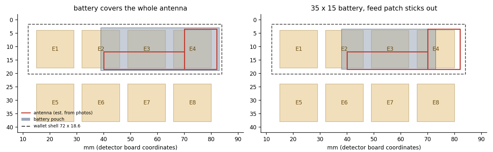
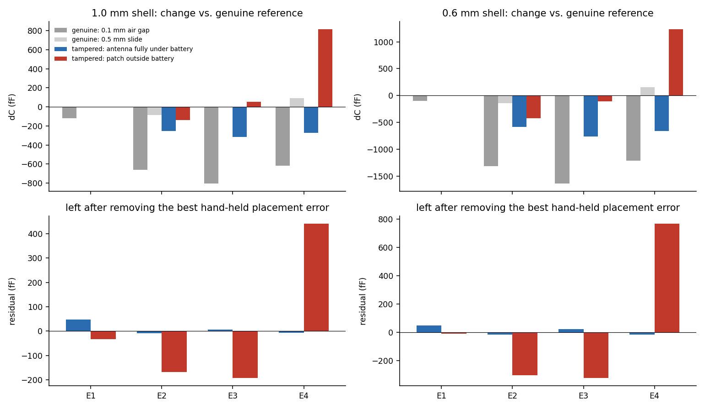

# Simulations: can the detector see the implant antenna, and not the battery?

> Status: **simulation of a concept**. The geometry is estimated from photos and
> the numbers depend on it. Use them to plan measurements, not as proof.

## What we are looking for

Photos of a tampered Nano show a flex LTE antenna (`AC-A2016-NANO-V1.1`)
glued to the inside of the plastic back. Under the black coverlay it is
**mostly solid copper**: a ~12 × 15 mm feed patch with etched slots (an outer
C-shaped frame around an inner tongue) plus a ~30 × 6.5 mm solid arm. The coax
is soldered at the junction and ends in a u.FL plug for the modem.

The difficulty is that the Ledger's **own battery** is glued to the same back,
and the antenna sits *between* the shell and the battery. A genuine unit
therefore already has a large conductor, the pouch's aluminium foil, at almost
exactly the depth where the antenna would be. A detector that just says "more
metal here" would flag every genuine unit. The simulations compare
**genuine (shell + battery)** against **tampered (shell + antenna + battery)**.



Antenna and battery outlines are estimates (red / grey). Their relative
position is the most important unknown; see the end of this document.

## 1. Capacitive array (`sim/electrostatic.py`)

A 3D finite-volume Laplace solver (scipy + pyamg, ~2.3 M nodes) models the real
detector stack-up:

- the 14 × 14 mm electrodes on B.Cu;
- the In1 GND shield 1.3 mm behind them, and the FR4;
- a 1.0 mm (Nano) or 0.6 mm (Flex / Stax) plastic back, εr = 3;
- the battery pouch as a floating 4 mm conductor, and the wallet's main board
  as a floating plate;
- in the tampered case, the antenna (εr 3.4 flex, 0.15 mm thick) between shell
  and battery, which pushes the battery 0.15 mm further from the shell.

Floating conductors are handled exactly through the Maxwell capacitance matrix.
The solver reproduces a parallel-plate capacitor with fringing to within 1 %.

To estimate false positives, the same **genuine** unit is also simulated with a
0.1 mm air gap and slid 0.5 mm along the board. These stand in for placement
errors.



Top: change of each electrode's capacitance against the genuine reference.
Bottom: what remains after subtracting the best-fitting **hand-held placement
error** (air gap within ±0.1 mm, slide within ±1 mm, linearised). That
remainder is the part a placement error cannot explain.

| shell | battery vs antenna | antenna | largest unexplained change, jig | hand-held |
|---|---|---|---|---|
| 1.0 mm | battery covers the whole antenna | floating | **48 fF** | **48 fF** |
| 1.0 mm | battery covers the whole antenna | tied to a large ground (upper bound) | 991 fF | 591 fF |
| 1.0 mm | feed patch outside the battery | floating | **533 fF** | **440 fF** |
| 1.0 mm | feed patch outside the battery | tied to a large ground (upper bound) | 2108 fF | 1709 fF |
| 0.6 mm | battery covers the whole antenna | floating | 47 fF | 47 fF |
| 0.6 mm | feed patch outside the battery | floating | 921 fF | 767 fF |

(Electrode capacitance is ~10 pF. The FDC2214 noise floor is 0.3 fF at
100 S/s, so the instrument is never the limit: placement and unit-to-unit
variation are.)

### What this says

1. **Placement dominates the raw signal.** A 0.1 mm air gap under a genuine
   unit changes the electrodes by −0.6 to −0.8 pF, more than most tampering
   signatures. A fixed threshold on raw capacitance would be useless. The tool
   must press the wallet flat (jig / spring clamp) and the firmware must judge
   the **shape** of the 8-channel signature, not its size.
2. **Antenna copper outside the battery's shadow is clearly detectable.** It
   gives a positive bump on the electrode over it while its neighbours go
   slightly negative. No air gap or slide produces that pattern. About 0.4–0.9 pF
   is left after removing the worst plausible placement error.
3. **An antenna fully hidden behind the battery and electrically floating is
   invisible capacitively.** Antenna and foil are 0.15 mm apart over a large
   area, so at the FDC2214's ~6 MHz they behave as one conductor. The only
   remaining effect is "the battery sits 0.15 mm deeper", which looks like
   an air gap or a slightly thicker glue line in a genuine unit (~50 fF of
   shape difference).
4. **If the antenna's coax shield is tied to a large ground** (e.g. the
   implant takes power from the Ledger's battery, so its ground is the
   wallet's ground), the antenna becomes detectable even under the battery.
   The grounded figures in the table are an upper bound, because the model's
   ground is ideal.
5. A thinner back (Flex / Stax, 0.6 mm) roughly doubles every effect, both
   signal and placement sensitivity.

A working LTE antenna lying flat on a battery foil 0.15 mm away would barely
radiate. So a real implant probably *needs* part of its antenna outside the
battery outline, which is the case the array detects. The RF simulation below
is meant to check that.

## 2. Near-field RF loop (`sim/rf_fdtd.py`)

A 3D FDTD model in numba, with graded absorbing boundaries and lumped 50 Ω
elements. It has been validated against a cavity resonance (2.399 vs.
2.401 GHz), a parallel-plate capacitor (+1 %) and a loop inductance (−6 % for
a square loop, +15 % for the staircased circle).

The model contains the board's actual 8 mm loop with its In1 / F.Cu ground
cut-out, FR4 and the floating electrodes, over the wallet. It compares:

- **genuine**;
- **tampered**: the slotted patch and arm from the photo, coax feed terminated
  in the modem's 50 Ω;
- **control**: plain copper of the same outline, with no slots and no feed.

It runs at three loop positions (over the patch, mid-arm, arm tip) and for
both battery cases. The output is S11 as `.s1p` files in `sim/results/rf/`,
which `tools/analyze_s1p.py` reads like NanoVNA files.

*Results: run in progress; this section will be filled in.*

## Unknowns that change the conclusions

Measure or photograph these on the tampered unit:

- **The battery's outline relative to the antenna.** Does any part of the
  antenna stick out beyond the pouch, and where? This decides between "clearly
  detectable" and "capacitively invisible" above.
- **Where the coax goes and what the implant's ground connects to.** Is it
  wired to the Ledger's battery or board ground?
- The exact antenna dimensions, the plastic thickness and the battery size. The
  geometry constants at the top of both scripts are all estimates.

## Running

Use Python ≤ 3.13 with `sim/requirements.txt`. NumPy 2.2.x, which numba 0.61
requires, silently miscomputes some expressions on Python 3.14; this was found
while validating the FDTD code.

```sh
python3.13 -m venv .venv && .venv/bin/pip install -r sim/requirements.txt
.venv/bin/python sim/electrostatic.py      # ~20 min on 18 processes
.venv/bin/python sim/rf_fdtd.py selftest
SIM_PROCS=8 SIM_THREADS=4 .venv/bin/python sim/rf_fdtd.py   # ~1 h per case
.venv/bin/python sim/report.py electrostatic
.venv/bin/python sim/report.py rf
```
