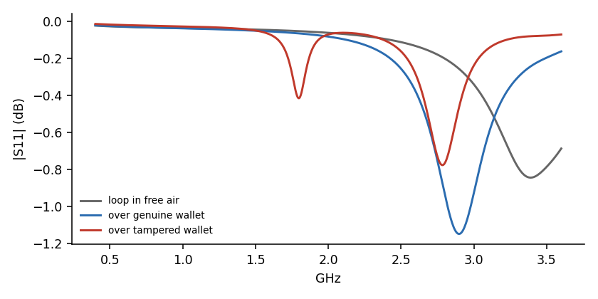
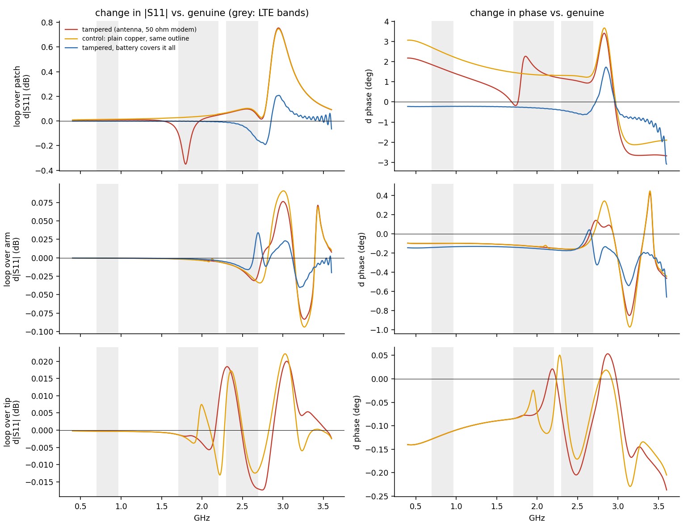

# Simulations: can the detector see the implant antenna, and not the battery?

> Status: **simulation of a concept**. The geometry is estimated from photos and
> the numbers depend on it. Use them to plan measurements, not as proof.

## What we are looking for

Photos of a tampered Nano show a flex LTE antenna (`AC-A2016-NANO-V1.1`)
glued to the inside of the plastic back. Under the black coverlay it is
**mostly solid copper**: a ~12 × 15 mm feed patch with etched slots (an outer
C-shaped frame around an inner tongue) plus a ~30 × 6.5 mm solid arm. The coax
is soldered at the junction and ends in a u.FL plug for the modem.

The difficulty is that the Ledger's **own battery** is glued to the same back,
and the antenna sits *between* the shell and the battery. A genuine unit
therefore already has a large conductor, the pouch's aluminium foil, at almost
exactly the depth where the antenna would be. A detector that just says "more
metal here" would flag every genuine unit. The simulations compare
**genuine (shell + battery)** against **tampered (shell + antenna + battery)**.


Antenna and battery outlines are estimates (red / grey). Their relative
position is the most important unknown; see the end of this document. The
third panel is a second, different implant (a wire spiral and a shortened
battery, see point 6 below).

## 1. Capacitive array (`sim/electrostatic.py`)

A 3D finite-volume Laplace solver (scipy + pyamg, ~2.3 M nodes) models the real
detector stack-up:

- the 14 × 14 mm electrodes on B.Cu;
- the In1 GND shield 1.3 mm behind them, and the FR4;
- a 1.0 mm (Nano) or 0.6 mm (Flex / Stax) plastic back, εr = 3;
- the battery pouch as a floating 4 mm conductor, and the wallet's main board
  as a floating plate;
- in the tampered case, the antenna (εr 3.4 flex, 0.15 mm thick) between shell
  and battery, which pushes the battery 0.15 mm further from the shell.

Floating conductors are handled exactly through the Maxwell capacitance matrix.
The solver reproduces a parallel-plate capacitor with fringing to within 1 %.

To estimate false positives, the same **genuine** unit is also simulated with a
0.1 mm air gap and slid 0.5 mm along the board. These stand in for placement
errors.


Top: change of each electrode's capacitance against the genuine reference.
Bottom: what remains after subtracting the best-fitting **hand-held placement
error** (air gap within ±0.1 mm, slide within ±1 mm, linearised). That
remainder is the part a placement error cannot explain.

| shell | battery vs antenna | antenna | largest unexplained change, jig | hand-held |
|---|---|---|---|---|
| 1.0 mm | battery covers the whole antenna | floating | **48 fF** | **48 fF** |
| 1.0 mm | battery covers the whole antenna | tied to a large ground (upper bound) | 991 fF | 591 fF |
| 1.0 mm | feed patch outside the battery | floating | **533 fF** | **440 fF** |
| 1.0 mm | feed patch outside the battery | tied to a large ground (upper bound) | 2108 fF | 1709 fF |
| 0.6 mm | battery covers the whole antenna | floating | 47 fF | 47 fF |
| 0.6 mm | feed patch outside the battery | floating | 921 fF | 767 fF |
| 1.0 mm | spiral implant, 26 mm battery (see below) | floating | **2382 fF** | **1982 fF** |
| 1.0 mm | spiral implant, 26 mm battery | board tied to the wallet's board | 1685 fF | 1285 fF |
| 0.6 mm | spiral implant, 26 mm battery | floating | 4130 fF | 3370 fF |
| 0.6 mm | spiral implant, 26 mm battery | board tied to the wallet's board | 3253 fF | 2493 fF |

(Electrode capacitance is ~10 pF. The FDC2214 noise floor is 0.3 fF at
100 S/s, so the instrument is never the limit: placement and unit-to-unit
variation are.)

### What this says

1. **Placement dominates the raw signal.** A 0.1 mm air gap under a genuine
   unit changes the electrodes by −0.6 to −0.8 pF, more than most tampering
   signatures. A fixed threshold on raw capacitance would be useless. The tool
   must press the wallet flat (jig / spring clamp) and the firmware must judge
   the **shape** of the 8-channel signature, not its size.
2. **Antenna copper extending beyond the battery's outline is clearly detectable.** It
   gives a positive bump on the electrode over it while its neighbours go
   slightly negative. No air gap or slide produces that pattern. About 0.4–0.9 pF
   is left after removing the worst plausible placement error.
3. **An antenna entirely within the battery's outline and electrically floating
   is invisible capacitively.** The copper is always between the shell and the
   battery, so from the detector it is *in front of* the foil. But it sits
   almost exactly where the foil's front face is in a genuine unit, and the
   antenna and foil are 0.15 mm apart over a large area (~40 pF between them),
   so at the FDC2214's ~6 MHz they behave as one conductor. The only remaining
   effect is "the battery sits 0.15 mm deeper", which looks like an air gap or
   a slightly thicker glue line in a genuine unit (~50 fF of shape
   difference).
4. **If the antenna's coax shield is tied to a large ground** (e.g. the
   implant takes power from the Ledger's battery, so its ground is the
   wallet's ground), the antenna becomes detectable even within the battery's
   outline.
   The grounded figures in the table are an upper bound, because the model's
   ground is ideal.
5. A thinner back (Flex / Stax, 0.6 mm) roughly doubles every effect, both
   signal and placement sensitivity.

6. **A second, quite different implant is caught by its shortened battery.**
   Joe Grand's tampered Nano X ([slides](https://grandideastudio.com/media/ledger_hardware_implant_slides.pdf),
   pp. 33-38) replaces the 44 mm battery with a 26 mm one and puts the implant
   board and a hand-wound ~6 mm wire spiral antenna in the freed space. The
   electrode over that space (E4) loses 2-5 pF, because the foil it saw in a
   genuine unit is gone. No air gap or slide gives one electrode a drop that
   large while its neighbours barely move. After the worst hand-held placement
   error, 1.3-3.4 pF is left, far above anything else in the table. Whether
   the implant's ground is tied to the wallet's board hardly matters. The
   model's layout (third panel of the geometry figure) is estimated from the
   photos, and at ~6 MHz the touching turns of the spiral act as one small
   plate. The RF side of this variant is simulated in
   [fixtures.md](fixtures.md#second-implant-variant-a-hand-wound-spiral).

A working LTE antenna lying flat on a battery foil 0.15 mm away would barely
radiate. So a real implant probably *needs* part of its antenna beyond the
battery's outline, which is the case the array detects. The RF simulation below
is meant to check that.

## 2. Near-field RF loop (`sim/rf_fdtd.py`)

A 3D FDTD model in numba, with graded absorbing boundaries and lumped 50 Ω
elements. It has been validated against a cavity resonance (2.399 vs.
2.401 GHz), a parallel-plate capacitor (+1 %) and a loop inductance (−6 % for
a square loop, +15 % for the staircased circle).

The model contains the board's actual 8 mm loop with its In1 / F.Cu ground
cut-out, FR4 and the floating electrodes, over the wallet. It compares:

- **genuine**;
- **tampered**: the slotted patch and arm from the photo, coax feed terminated
  in the modem's 50 Ω;
- **control**: plain copper of the same outline, with no slots and no feed.

It runs at three loop positions (over the patch, mid-arm, arm tip) and for
both battery cases. The output is S11 as `.s1p` files in `sim/results/rf/`,
which `tools/analyze_s1p.py` reads like NanoVNA files.





Rows: loop over the feed patch (which, in the 35 × 15 battery case, extends
beyond the battery's outline), over the middle of the arm, and over the arm
tip; the arm lies within the battery's outline. Left: change in |S11| against
the genuine unit. Right: change in phase.

| loop position | case | 699–960 MHz | 1710–2200 MHz | 2300–2690 MHz |
|---|---|---|---|---|
| over the patch | tampered (antenna, 50 Ω modem) | 0.01 dB | **0.35 dB** dip at 1.8 GHz | 0.10 dB |
| over the patch | control: plain copper, same outline | 0.01 dB | 0.06 dB | 0.10 dB |
| over the arm | tampered / copper | < 0.01 dB | 0.01 dB | 0.03 dB |
| over the arm tip | tampered / copper | < 0.01 dB | 0.01 dB | 0.02 dB |

### What this says

1. **A tuned, loaded antenna has a signature that plain metal does not.**
   Over the feed patch the tampered unit shows a narrow absorption dip at
   ~1.8 GHz (LTE band 3), about 0.35–0.4 dB deep and ~100 MHz wide. The
   plain-copper control with the same outline has no dip, and neither does the
   genuine unit with its battery. It only shows the same broad shift around
   2.9 GHz that any extra copper causes. This is exactly the discrimination
   the capacitive array cannot make: **copper vs. an antenna**.
2. **The exact frequency is not trustworthy.** It depends on the real slot
   pattern, which is approximated from a photo, and on the modem's real input
   impedance. The mechanism is what matters: look for a *narrow, in-band
   absorption feature* that a genuine reference does not have.
3. **Copper lying on the battery foil is RF-dead.** Over the arm, which lies
   within the battery's outline, changes stay below 0.1 dB at every
   frequency. When the battery covers the whole antenna, the 1.8 GHz dip
   disappears too. An antenna in that position would not work as an antenna,
   which again suggests a real implant needs copper beyond the battery's
   outline.
4. **The probe has to sit over the right spot.** The feature is local to
   the feed patch. It is ~0.4 dB at 2.7 mm from the copper and fades within a
   few mm. Scanning (or a small array of loops) is needed.
5. **The loop's own self-resonance (~2.9 GHz over a wallet, 3.4 GHz in air)
   sits close to the upper LTE band.** Any copper shifts it, so it causes
   broad differences there. For the integrated rev 0.2 a smaller or
   differently loaded loop should push it above ~3.5 GHz.

### Implication for a VNA-less front end (rev 0.2)

A 0.35 dB dip, narrow in frequency, sitting on a smooth baseline is a
**magnitude** feature. A scalar front end (PLL synthesizer + reflection bridge
+ log detector) with ~0.05 dB short-term resolution, sweeping 0.6–3 GHz in
~5 MHz steps, should resolve it. The decision rule is "a narrow dip that the
reference sweep does not have", which is insensitive to the broadband
placement effects that dominate the capacitive channel. Phase would help but
does not look necessary, subject to NanoVNA measurements on the real unit
(see [rf_measurements.md](rf_measurements.md)). The simulated `.s1p` files in
`sim/results/rf/` can be compared directly with those measurements.

## Combined picture

| | capacitive array | RF loop |
|---|---|---|
| copper beyond the battery's outline | **detects it** (0.4–0.9 pF above placement error) | detects extra copper (broad shift) |
| tells an antenna from plain copper | no | **yes**: narrow in-band absorption at the feed |
| copper entirely within the battery's outline | no (≈ 50 fF, looks like glue thickness) | no (< 0.1 dB), but such an antenna would barely radiate |
| main error source | air gap / placement (0.1 mm → −0.7 pF) | probe position over the feed area |

The two channels are complementary. The capacitive array finds copper
*where a genuine unit has none*. The RF sweep checks whether that copper
*behaves like a loaded antenna*, which is what rules out false positives
from batteries, shields and other plain metal.

## Unknowns that change the conclusions

Measure or photograph these on the tampered unit:

- **The battery's outline relative to the antenna.** The copper is always
  between shell and battery; the question is how much of it extends beyond the
  pouch's outline, and where. This decides between "clearly detectable" and
  "capacitively invisible" above.
- **Where the coax goes and what the implant's ground connects to.** Is it
  wired to the Ledger's battery or board ground?
- The exact antenna dimensions, the plastic thickness and the battery size. The
  geometry constants at the top of both scripts are all estimates.

## Running

Use Python ≤ 3.13 with `sim/requirements.txt`. NumPy 2.2.x, which numba 0.61
requires, silently miscomputes some expressions on Python 3.14; this was found
while validating the FDTD code.

```sh
python3.13 -m venv .venv && .venv/bin/pip install -r sim/requirements.txt
.venv/bin/python sim/electrostatic.py      # ~20 min on 18 processes
.venv/bin/python sim/rf_fdtd.py selftest
SIM_PROCS=8 SIM_THREADS=4 .venv/bin/python sim/rf_fdtd.py   # ~1 h per case
.venv/bin/python sim/report.py electrostatic
.venv/bin/python sim/report.py rf
```
